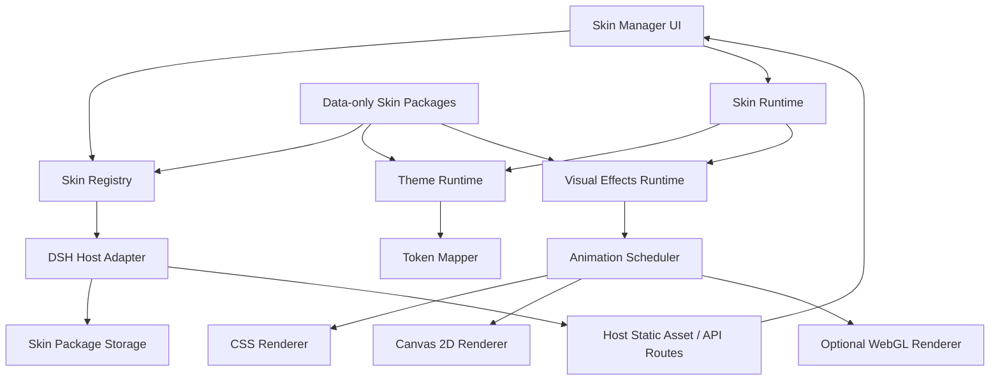

# 02 · Technical Architecture

## 1. 总体架构



## 2. 模块职责

| 模块 | 职责 | 不负责 |
|---|---|---|
| Skin Manager UI | 列表、详情、预览、应用、导入导出 | 直接注入全局 CSS |
| Skin Registry | 扫描、索引、校验、兼容性 | 渲染效果 |
| Skin Runtime | 当前皮肤状态、切换、回滚、卸载 | 具体视觉算法 |
| Theme Runtime | Tokens 解析、Host Token 映射 | 粒子动画 |
| Visual Effects Runtime | 内置效果注册、参数解析、调度 | 皮肤安装 |
| CSS Renderer | 玻璃、极光、流光、虹彩 | 高密度粒子模拟 |
| Canvas 2D Renderer | Dust、Starfield、Ripple | DOM 布局 |
| WebGL Renderer | 可选液态折射 Shader | 默认基础 UI |
| DSH Host Adapter | 宿主 Token、表面挂载点、共存标记 | 皮肤业务配置 |
| Package Storage | 本地皮肤目录、静态资源服务 | 浏览器渲染 |

## 3. 建议源码目录

```text
packages/dsh-skin-engine/
├── package.json
├── manifest.schema.json
├── src/
│   ├── host/
│   │   ├── index.ts
│   │   ├── routes.ts
│   │   ├── package-storage.ts
│   │   └── compatibility.ts
│   ├── client/
│   │   ├── index.ts
│   │   ├── SkinManager.tsx
│   │   └── skin-manager.css
│   ├── core/
│   │   ├── manifest.ts
│   │   ├── registry.ts
│   │   ├── runtime.ts
│   │   ├── lifecycle.ts
│   │   ├── preferences.ts
│   │   └── transition.ts
│   ├── adapter/
│   │   ├── dsh-host.ts
│   │   ├── surface-map.ts
│   │   └── coexistence.ts
│   ├── theme/
│   │   ├── token-resolver.ts
│   │   ├── token-mapper.ts
│   │   └── css-loader.ts
│   └── effects/
│       ├── registry.ts
│       ├── scheduler.ts
│       ├── quality-manager.ts
│       ├── renderers/css.ts
│       ├── renderers/canvas2d.ts
│       ├── renderers/webgl.ts
│       └── builtins/
│           ├── liquid-glass.ts
│           ├── aurora.ts
│           ├── floating-dust.ts
│           ├── light-flow.ts
│           ├── click-ripple.ts
│           ├── starfield.ts
│           ├── holographic-glass.ts
│           └── liquid-refraction.ts
└── assets/skins/
    ├── deep-ocean/
    ├── aurora/
    └── obsidian-neon/
```

## 4. 运行流程

### 启动

1. Host 侧解析 Skin Storage，读取 Manifest 元数据。
2. Registry 校验 `schema`、`engineApi`、`dshCompatibility` 和资源路径。
3. Browser Runtime 读取持久化的 `activeSkinId`。
4. 如果当前皮肤不兼容或资源不可用，回退到 `default`。
5. 加载 Tokens、CSS 和 Effects Profile。
6. Adapter 检查宿主支持的表面能力，挂载安全效果层。
7. Effects Runtime 启动必要的调度任务。

### 切换

1. 预加载目标皮肤资源，不先卸载当前皮肤。
2. 验证目标包完整且兼容。
3. 暂停旧效果，进入短暂过渡态。
4. 应用目标 Tokens 与 CSS。
5. 启动目标 Effects Profile。
6. 确认目标样式挂载成功后提交活动状态。
7. 释放旧皮肤资源。
8. 任一步失败则清理目标并恢复旧皮肤。

### 卸载

1. 若卸载的是当前皮肤，先切换到 Default。
2. 调用效果 `dispose()`，取消 RAF、Observer、Listener、Canvas 和 WebGL 资源。
3. 移除 CSS Link、根节点属性和引擎写入的变量。
4. 删除包目录。
5. 保留用户配置备份，除非用户明确选择同时删除。

## 5. Host API 建议

以下是拟定的稳定契约，不代表已经确认 DSH 当前版本存在同名 API；M0 必须映射到真实 `webServer` / plugin context 能力。

| 方法 | 用途 |
|---|---|
| `GET /api/dsh/skin-engine/skins` | 读取皮肤元数据与兼容状态 |
| `GET /api/dsh/skin-engine/skins/:id/manifest` | 获取单个 Manifest |
| `GET /api/dsh/skin-engine/skins/:id/assets/*` | 安全提供 CSS、图片、字体 |
| `POST /api/dsh/skin-engine/install` | 导入 `.dshskin.zip` |
| `DELETE /api/dsh/skin-engine/skins/:id` | 卸载皮肤 |
| `PUT /api/dsh/skin-engine/active` | 持久化活动皮肤 ID |
| `GET /api/dsh/skin-engine/preferences` | 读取用户配置 |
| `PUT /api/dsh/skin-engine/preferences` | 保存用户配置 |

Host Route 必须校验路径、请求大小、包 ID 和文件类型。不能把用户输入直接拼接为文件系统路径。

## 6. 状态模型

```text
UNINITIALIZED
  -> DISCOVERING
  -> READY
  -> PREVIEWING
  -> SWITCHING
  -> ACTIVE
  -> DISPOSING
  -> READY

错误状态：INVALID_PACKAGE / INCOMPATIBLE / LOAD_FAILED / ROLLBACK_FAILED
```

- `ACTIVE` 只能有一个。
- `PREVIEWING` 不覆盖持久化活动皮肤。
- `DISPOSING` 必须可重复调用。
- `ROLLBACK_FAILED` 必须触发原生主题兜底，并记录诊断信息。
