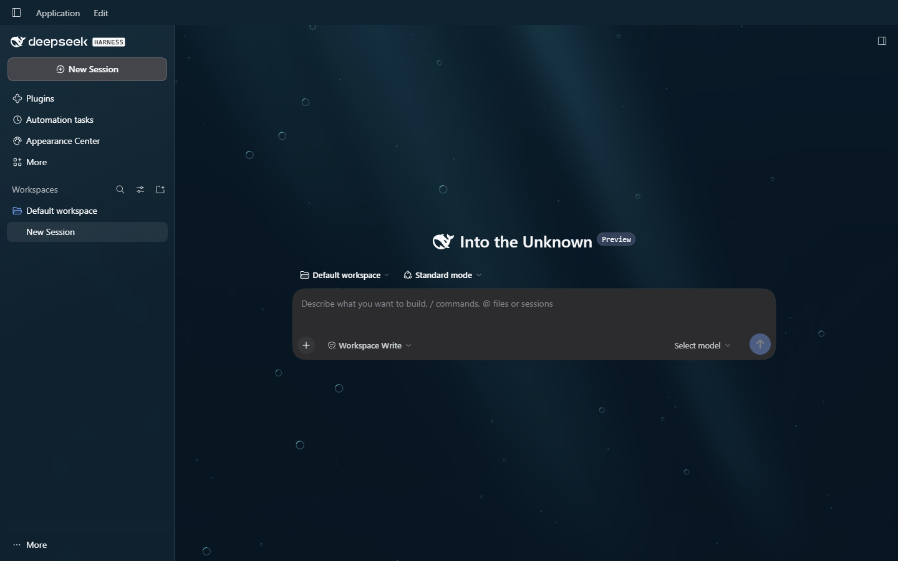
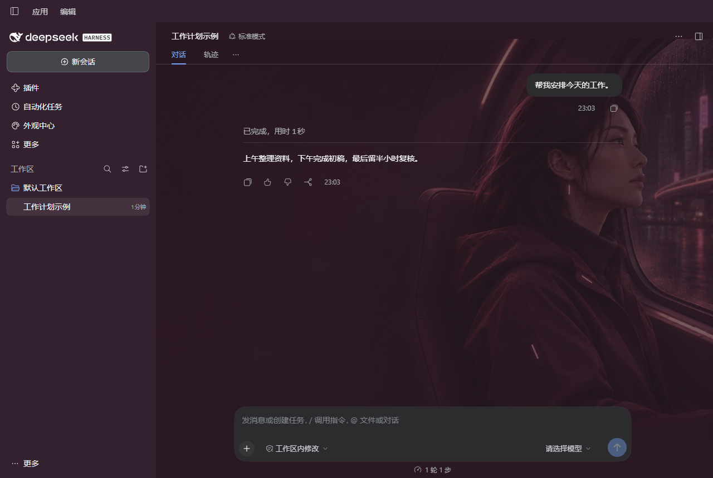
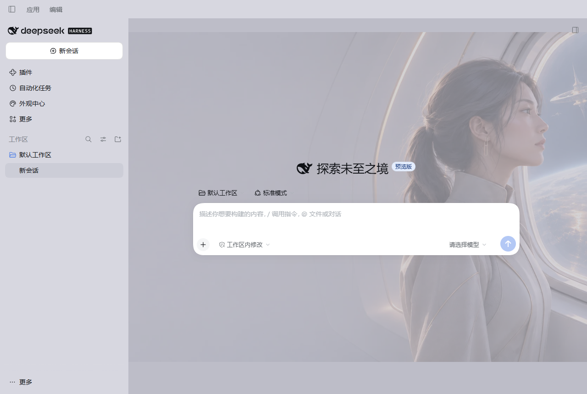
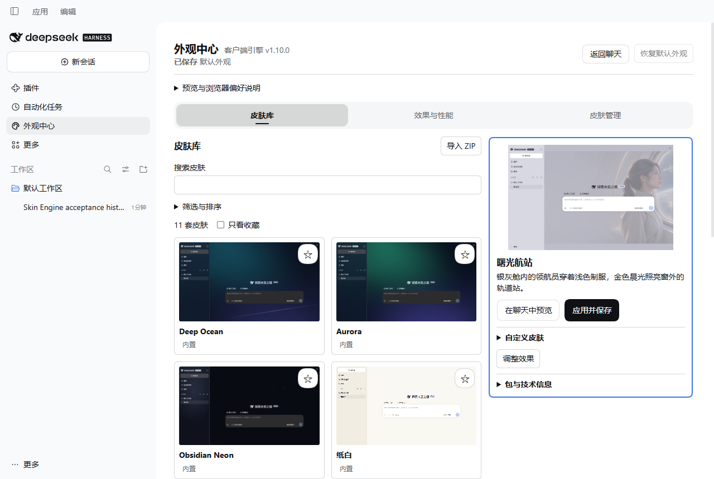

# DSH Skin Engine

[简体中文](README.md) · English

**Make DeepSeek Harness feel like yours. Try a skin in a real chat before you save it.**

Open **Appearance Center** from the sidebar to find a quiet background for writing, a dark theme with drifting auroras, or a workspace with an illustrated character on the right.

[Download releases](https://github.com/Activer007/dsh-skin-engine/releases) · [Installation and upgrades (Chinese)](docs/release-v1.md#安装与启用) · [1.10.0 release notes (Chinese)](docs/release-v1.md#v1100-新版外观中心)

https://github.com/user-attachments/assets/9020aa7b-329e-4af7-a1d6-0049cfcdc728

**Underwater effects demo.** The first three seconds show Living Light VI with underwater light shafts, rising bubbles, and sidebar effects. Deep Ocean follows with floating dust at 2× speed and liquid refraction at normal speed. [HD MP4](docs/images/showcase/deep-ocean-effects.mp4)

Living Light VI 1.2.0 is a separate `.dshskin.zip` skin. When v1.10.3 is available, download the skin ZIP from GitHub Releases and import it under **Appearance Center → Skin gallery → Import ZIP**. You can also build it from source before release. [GitHub Releases](https://github.com/Activer007/dsh-skin-engine/releases) · [Skin packaging guide (Chinese)](skin-sources/examples/README.md)

## Find a skin that suits you

**Browse quickly.** Search, filters, and favorites update instantly. Static thumbnails load as you scroll.

**Save resources in the background.** Effects pause while the window is hidden and resume when you return. Choose Economy or Static mode for any window.

- **11 built-in skins.** Explore large cards, star your favorites, and find them again with search or the Favorites only filter.
- **A 30-second preview in chat.** See the skin on an actual conversation. Save it from the countdown panel or cancel to return to the same tab with your draft intact.
- **Use your own artwork.** Six character skins let you replace the illustration and adjust its position, scale, and opacity. Collapsing Customize skin keeps your draft.
- **Set the mood.** Adjust effect strength or restore the default DSH appearance. Import or export custom skins as ZIP files.

**Living Light VI** shows light shafts from above, with floating dust and bubbles visible in the sidebar.

**Crimson Rain** keeps the character on the right, leaving room for the conversation.

**Dawn Station** pairs a pale cabin with early morning light.

## Install and get started

Requires **DSH 0.2.2-rc.1 or later**. Download a .tgz from [GitHub Releases](https://github.com/Activer007/dsh-skin-engine/releases) and follow the [Windows or Web installation guide (Chinese)](docs/release-v1.md#安装与启用). Before upgrading, quit DSH and back up your profile.

Open **Appearance Center → Skin gallery**, choose a skin, then select **Preview in chat** or **Apply**. To try your own illustration, choose Dawn Station or Night Navigator and open **Customize skin**.

[Portrait customization (Chinese)](docs/user-artwork-stage1.md) · [Skin authoring examples (Chinese)](skin-sources/examples/README.md) · [Project history](docs/history.md) · [Roadmap (Chinese)](docs/development-roadmap.md) · [R2 action plan (Chinese)](docs/r2-issue-action-plan-20261118.md)

## License and contact

All character illustrations, wallpapers, and scene artwork used in Skin Engine's built-in skins and official examples were independently created by the project author, either directly or with generative tools. None of this artwork was copied from other projects. The Skin Engine source code is licensed under the [MIT License](LICENSE). DeepSeek Harness UI, names, and logos visible in screenshots or videos, as well as third-party dependencies, retain their respective ownership and license terms. See the [asset notes](docs/release-asset-notes.md).

Contact [85155.00@gmail.com](mailto:85155.00@gmail.com).
