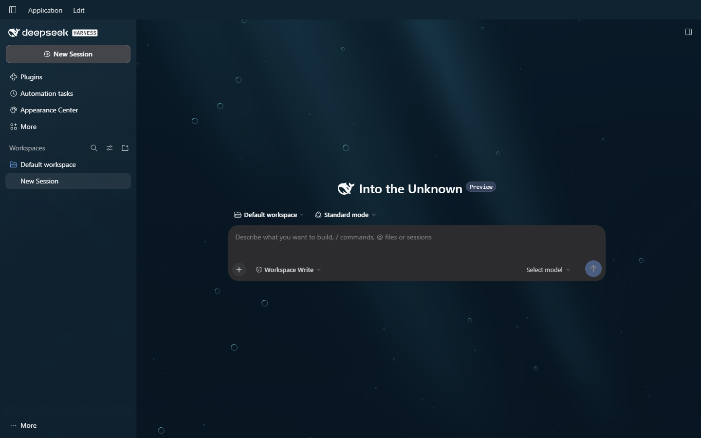
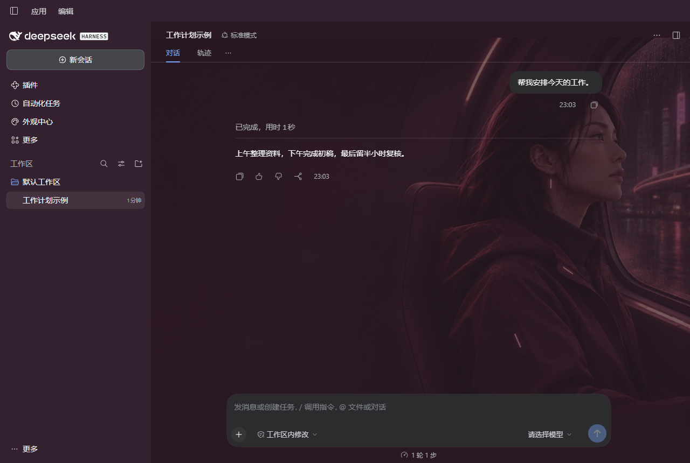
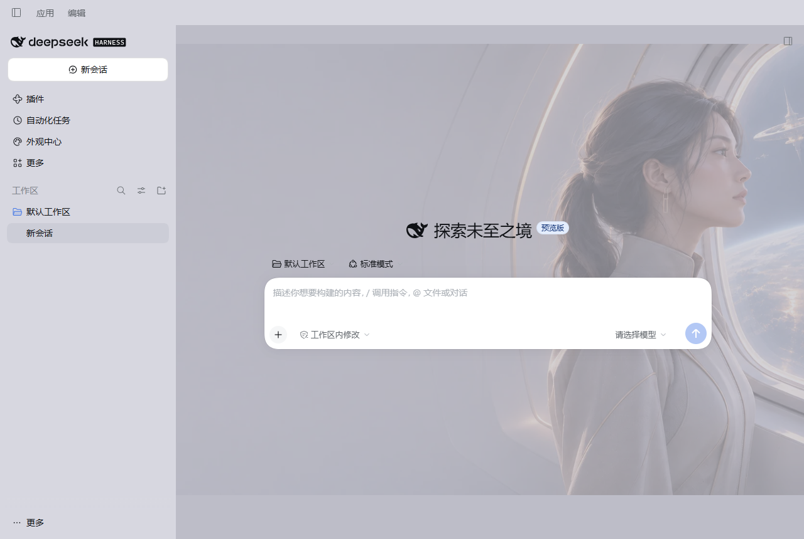
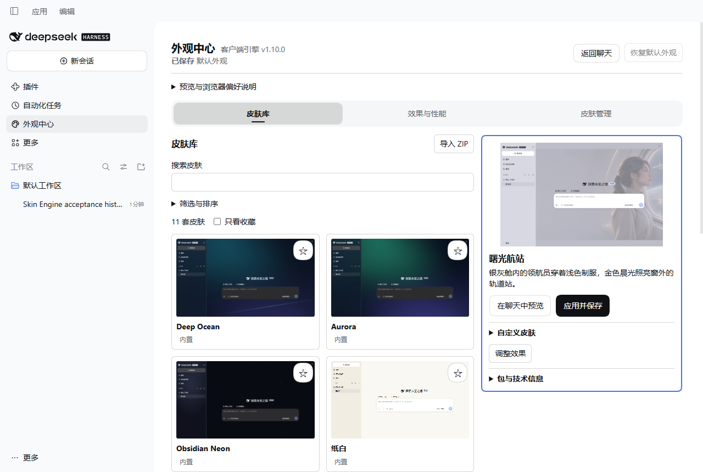

# DSH Skin Engine

简体中文 · [English](README.en.md)

**给 DeepSeek Harness 换个外观，在真实聊天里试好再保存。**

从左侧打开「外观中心」，挑一款喜欢的皮肤。想要安静的写作背景、带极光的深色界面，或右侧带人物插画的工作空间，都可以先看看实际效果。

[下载 v1.11.0](https://github.com/Activer007/dsh-skin-engine/releases/tag/v1.11.0) · [安装与升级](docs/release-v1.md#安装与启用) · [版本说明](docs/release-v1.md#v1110-个人图片与特效参数)

https://github.com/user-attachments/assets/9020aa7b-329e-4af7-a1d6-0049cfcdc728

**深海动效演示。** 前 3 秒展示「浮光深境 VI」的深海光束、上浮气泡和侧栏动效，随后是 Deep Ocean 的 2 倍速浮尘和原速液态折射。 [高清 MP4](docs/images/showcase/deep-ocean-effects.mp4)

「浮光深境 VI」1.2.0 是独立皮肤。下载 `com.dsh.skin.deep-ocean-living-light.dshskin.zip`，再在 **外观中心 → 皮肤库 → 导入 ZIP** 中导入。 [GitHub Releases](https://github.com/Activer007/dsh-skin-engine/releases) · [皮肤打包说明](skin-sources/examples/README.md)

## 找到适合你的外观

**浏览响应快。** 搜索、筛选和收藏即时更新，静态缩略图随滚动按需加载。

**动效更省资源。** 窗口隐藏时暂停绘制，回到前台自动恢复。也可按窗口切换到节能或静态模式。

- **11 款内置皮肤。** 从 Deep Ocean 的深蓝与流光，到纸白的暖色阅读界面。用大图卡片浏览，用星标收藏，也可搜索或只看收藏。
- **在聊天里试用 30 秒。** 倒计时内可以直接保存。取消后回到原页签，刚才的改动还在。画廊显示静态缩略图，聊天预览能看到实际动态效果。
- **换上自己的图片。** 六款人物皮肤支持替换插画，调整位置、缩放和透明度。展开「自定义皮肤」就能编辑，收起也会保留草稿。
- **按需要调节氛围。** 可以调低特效或保持静态，也可以恢复 DSH 默认外观。自制皮肤可通过 ZIP 导入、导出和分享。

**浮光深境 VI** · 深海光束从上方落下，浮尘和气泡也出现在侧栏。

**绯雨霓虹** · 右侧是雨夜人物插画，聊天仍有独立的阅读区域。

**曙光航站** · 银灰舷窗映着晨光，适合喜欢浅色外观的人。

## 安装与上手

需要 **DSH 0.2.2-rc.1 或更新版本**。从 [GitHub Releases](https://github.com/Activer007/dsh-skin-engine/releases) 下载安装包，再按 [Windows 和 Web 安装说明](docs/release-v1.md#安装与启用) 安装。升级前请退出 DSH 并备份原配置。

安装后，打开 **外观中心 → 皮肤库**，选择皮肤，点击「在聊天中预览」或「应用并保存」。试试「曙光航站」或「夜航员」的 **自定义皮肤 → 人物场景图片**，换成自己的插画。

[人物换图说明](docs/user-artwork-stage1.md) · [皮肤作者入门](skin-sources/examples/README.md) · [项目沿革](docs/history.md) · [开发路线图](docs/development-roadmap.md) · [R2 修复任务书](docs/r2-issue-action-plan-20261118.md)

## 许可证与联系

Skin Engine 内置皮肤和官方样例中的人物插画、壁纸及场景美术素材均由项目作者自行创作或使用生成工具独立生成，没有直接复制其他项目的美术资源。Skin Engine 源码采用 [MIT 许可证](LICENSE)。演示截图或视频中的 DeepSeek Harness 界面、名称与标志，以及第三方依赖，仍遵循各自的权利归属和许可条款。详见[素材来源说明](docs/release-asset-notes.md)。

联系邮箱：[85155.00@gmail.com](mailto:85155.00@gmail.com)。
