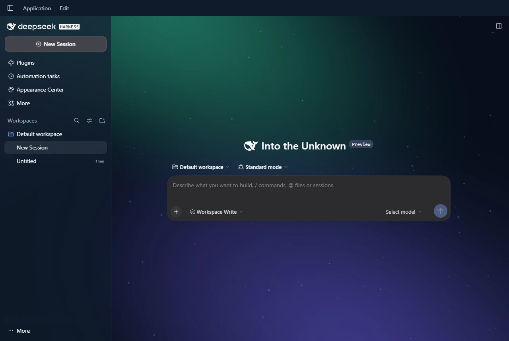
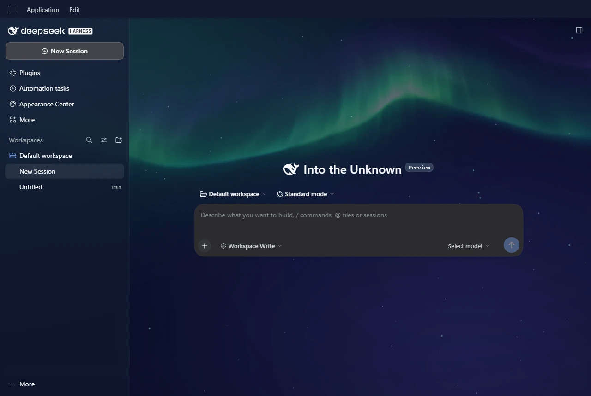

# Aurora V2「流光极幕」Alpha

本页记录 0.1.0 Alpha。复建此版 ZIP 时使用 [Alpha 源码提交](https://github.com/Activer007/dsh-skin-engine/tree/65b99bb3633c6f8e8324e77d83c58d34021207a9)。当前样例和实拍见 [Aurora V2 连续动态光幕](aurora-v2-curtain.md)。

Aurora V2 是一份独立的深色皮肤包。夜空上方的青绿主幕和靛紫副幕来自静态底图，现有引擎负责柔光变化、星点微闪和少量浮尘。正文和输入区保留深靛蓝底。光幕褶皱的实时形变属于后续的 A-V2-02。

- 皮肤 ID 为 `com.dsh.skin.aurora-v2`，包版本为 `0.1.0`（Alpha）。
- 需要 Engine API `^1.7.0` 和 DSH `>=0.2.2-rc.1`。可使用 Skin Engine `1.11.4` 导入。
- Aurora 原版与 V2 各自保存偏好。V2 可在「外观中心 → 皮肤管理」独立卸载。

## 打包与导入

在仓库根目录执行以下命令。

```powershell
npm ci --ignore-scripts
npm run pack:skin -- skin-sources/examples/skins/aurora-v2 .cache/a-v2-01/alpha
Get-FileHash -Algorithm SHA256 .cache/a-v2-01/alpha/com.dsh.skin.aurora-v2.dshskin.zip
```

验收 ZIP 为 39,923 字节，两次打包得到相同的 SHA-256 `dc5928836f10e2f48111f580d4581fab7fced34fc73d03d567a3037096200472`。在 DSH 的「外观中心 → 皮肤库」导入 ZIP，然后在聊天中试用或直接应用。

## 同场景实拍

两张截图均来自官方 DSH Windows Desktop `0.2.2-rc.5` 的隔离配置，使用 Skin Engine `1.11.4`。两款皮肤都以默认偏好应用在同一套 1280 × 860 CSS 像素的新会话布局中。

| Aurora 原版 | Aurora V2 Alpha |
| --- | --- |
| [](images/a-v2-01/aurora-original.webp) | [](images/a-v2-01/aurora-v2.webp) |

同一份 ZIP 通过导入、原版与 V2 共存、预览取消恢复原版、分别保存输入框透明度及卸载 V2。另对同一个含正文和代码块的会话做了对照。测试进程已退出，页面错误为零。

## 素材

`assets/aurora-ribbon.webp` 由项目使用内置 ImageGen 生成，再编码为 1672 × 941 的 WebP，SHA-256 为 `747a34c0aa48f88cf0a239866fdece8ee90f7faf69fb472859152986b9a181d5`。画廊封面来自隔离 DSH 的新会话实拍。截图内的 DSH 界面和标志归相应权利人。

<details>
<summary>静态底图生成提示词</summary>

> Create a 16:9 wide photorealistic aurora borealis sky background artwork for a dark desktop reading and chat theme named Aurora V2. Full-bleed atmospheric sky, no ground or horizon line, no mountains, trees, moon, clouds, or synthetic galaxy nebulae. The main visually recognizable aurora must be a coherent, smoothly curving fabric-like luminous horizontal ribbon with delicate vertical folds across x=15% to 99%, placed entirely between y=6% and y=39%. It has a highly legible S-curve with brighter translucent mint green and cool cyan edges and soft deep violet at the top fringe. A thinner and much dimmer violet secondary ribbon sits behind it at the upper right, adding depth. Place the brightest fold near x=67%, y=21% and keep it well away from the absolute top border. Distinct, gently curved natural folds and smooth falloff, no spots, no uniform hard stripes, no neon signs. Strong enough local contrast for the ribbon contour to remain visibly legible when overlaid at 35 percent opacity, with realistic modest color saturation. Add only very subtle low-noise atmospheric texture around the upper folds. The entire bottom 52% is calm, nearly uniform deep midnight indigo to slate navy, deliberately empty and dark behind white conversation text and controls. Lower half has no bands and no bright interference. No stars or particles anywhere because a separate runtime draws stars. No characters, icons, frames, lettering, overlays, logos or watermarks. Render as evocative and serene photographic sky with a luminous natural ribbon, suitable for full-bleed desktop background art.

</details>
