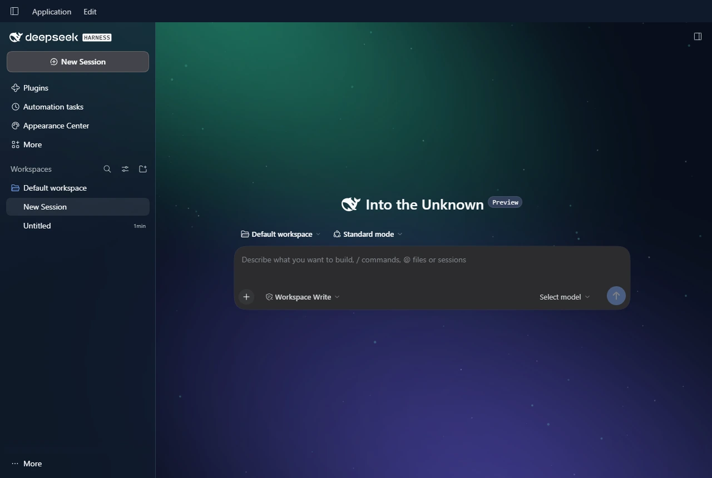
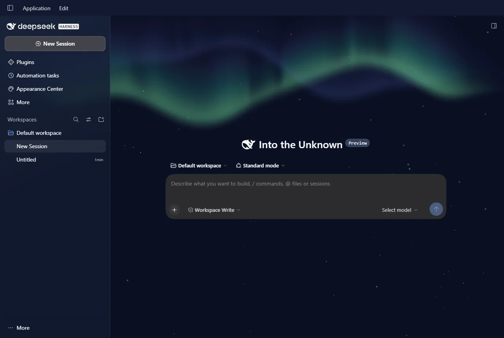

# Aurora V2 · 连续动态光幕

Aurora V2 `0.2.0` 使用新的 `ambient.aurora-curtain` 效果。青绿主幕缓慢横移，靛紫副幕提供纵深。光带的弧度、亮度和褶皱疏密缓慢变化。亮度、流速和褶皱幅度可在「外观中心 → 效果与性能」独立调整。星点继续使用 `particles.starfield`，位置固定，亮度缓慢变化。

| 设置 | 表现 |
| --- | --- |
| 亮度 | 0 隐藏光幕，星点继续显示 |
| 平衡画质 | 主幕和副幕缓慢变化 |
| 高画质 | 增加远层和褶皱采样 |
| 低画质、静态或系统减少动效 | 保留静态光幕 |
| 窗口隐藏 | 共享时钟暂停，恢复可见后继续 |

## 打包与升级

连续光幕需要 Engine API `^1.8.0`。使用本分支的 Skin Engine `1.12.0` 候选，DSH 要求仍为 `>=0.2.2-rc.1`。发布版 Skin Engine `1.11.4` 会拒绝该版本的皮肤包并提示引擎不兼容。

```powershell
npm ci --ignore-scripts
npm run build
$dest = '.cache/a-v2-02/final'
New-Item -ItemType Directory -Path $dest -Force
npm pack --ignore-scripts --pack-destination $dest
node scripts/pack-samples.mjs --source skin-sources/examples/skins/aurora-v2 $dest
```

在「外观中心 → 皮肤库」导入 `com.dsh.skin.aurora-v2.dshskin.zip`。已安装 0.1.0 的配置可从「皮肤管理」选择「从 .dshskin.zip 更新」。两版使用同一 V2 ID，原版 Aurora 仍是独立的内置皮肤。在 1.12.0 候选中可通过皮肤管理回退 V2 ZIP。降级至 1.11.4 时，先退出 DSH，再使用升级前的配置备份恢复选择文件。[配置回退说明](release-v1.md#回滚)

可信 Provider 在一个有界的 Canvas 缓冲中合成主幕、副幕和远层，复用窗口的共享动画时钟，光幕每秒最多重绘 20 次。光幕下缘淡入夜空，褶皱沿光带聚拢和散开，细小的亮纹在褶皱内缓慢漂移。皮肤包声明效果参数，画廊封面来自隔离 Windows DSH 实拍。

## 实拍与验证

官方 DSH Web 和 Windows Desktop `0.2.2-rc.5` 使用同一份候选引擎和皮肤 ZIP。两个宿主各取三个时刻，独立光幕缓冲的像素摘要均变化。低画质、静态、减少动效分别保持光幕像素稳定，恢复系统动效后继续变化。亮度归零时只隐藏光幕。流速和褶皱幅度的保存值分别为 25% 和 51%。

Web 从 V2 Alpha `0.1.0` 升级后，已关闭的极光继续保持关闭，编辑器继承原有的 24% 亮度。重新开启后，新光幕沿用该亮度并保存自己的偏好，旧偏好仍可用于回退。Windows 另检查了 760 CSS 像素宽的正文和输入区。两端切回原版后恢复原版 Aurora，页面和 Provider 无错误，测试宿主均已退出。[产物校验值和逐项记录](evidence/a-v2-02.json)

| Aurora 原版 | 连续光幕 · 第一个时刻 |
| --- | --- |
| [](images/a-v2-02/aurora-original.webp) | [](images/a-v2-02/aurora-v2-phase-1.webp) |

[第二个时刻](images/a-v2-02/aurora-v2-phase-2.webp) · [第三个时刻](images/a-v2-02/aurora-v2-phase-3.webp)
