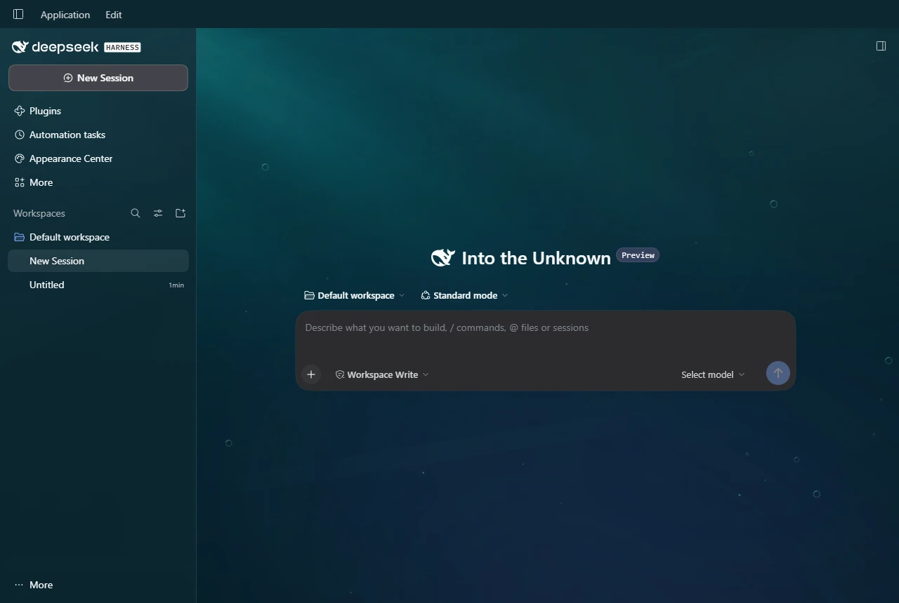
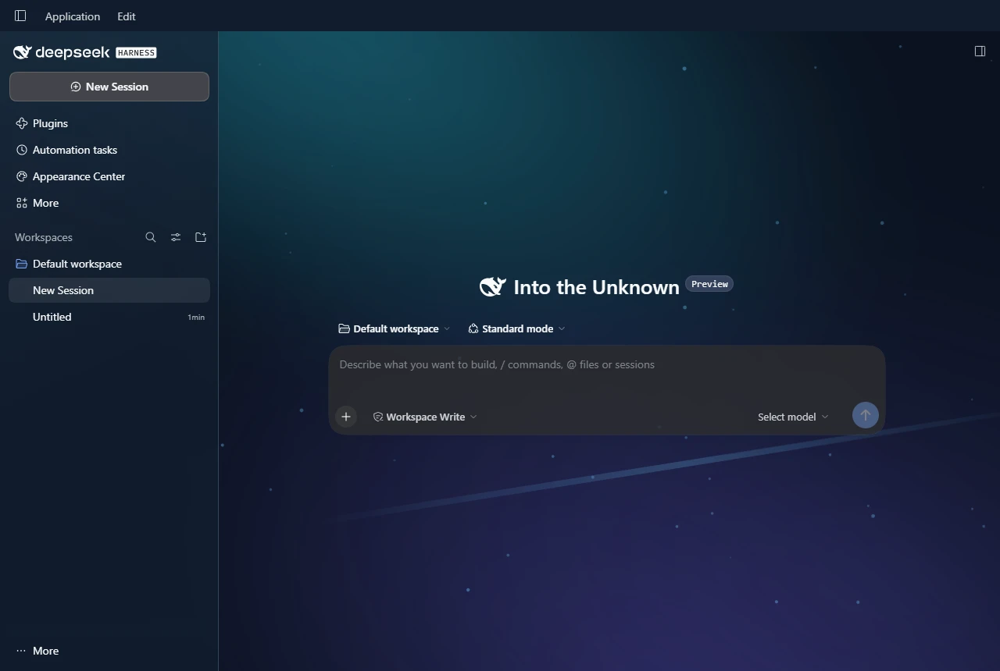
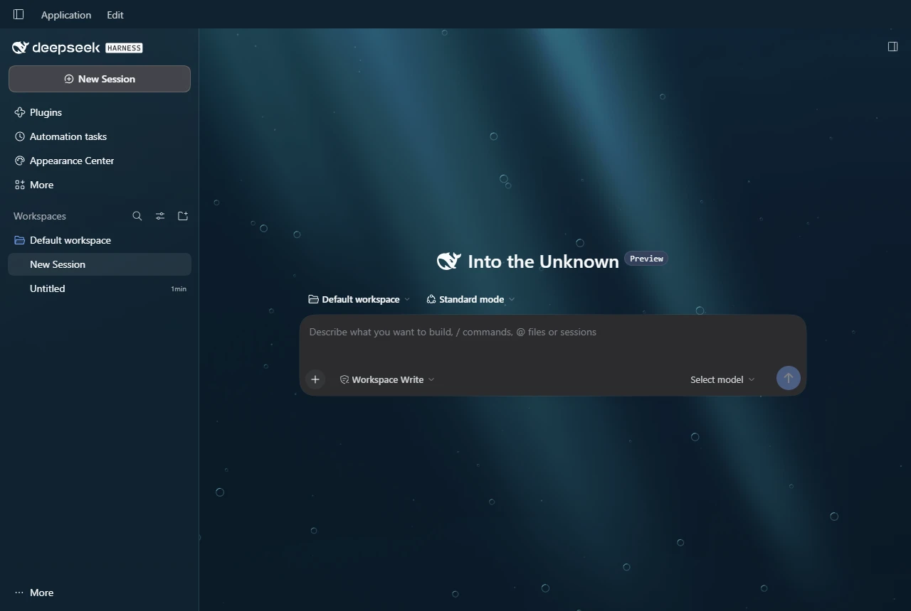

# Deep Ocean V2 Alpha

本文记录 Alpha 0.1.0。复建该 ZIP 请在提交 `fbee2eb` 打包。当前版本见[动态光场](deep-ocean-v2-lightfield.md)。

Deep Ocean V2「深海光境」是一份独立的深色皮肤包。青绿柔光从上方斜入水体，细小浮尘和缓慢上升的气泡提供近远层次。亮区集中在上方，中部和输入区保留深色底。底图提供静态的顶部光束，现有引擎负责柔光变化、光流、粒子和玻璃效果。独立可控的动态光束和体积散射留给 O-V2-02 的视觉验证。

- 皮肤 ID 为 `com.dsh.skin.deep-ocean-v2`，包版本为 `0.1.0`（Alpha）。
- 需要 Engine API `^1.7.0` 和 DSH `>=0.2.2-rc.1`。使用 Skin Engine `1.11.4` 即可导入。
- 原版 Deep Ocean 保持内置，浮光深境 VI 保持独立 ZIP。三款皮肤各自保存偏好。Deep Ocean V2 可从「外观中心 → 皮肤管理」独立卸载。

## 打包与导入

在仓库根目录执行以下命令。

```powershell
npm ci --ignore-scripts
npm run pack:skin -- skin-sources/examples/skins/deep-ocean-v2 .cache/o-v2-01/alpha
Get-FileHash -Algorithm SHA256 .cache/o-v2-01/alpha/com.dsh.skin.deep-ocean-v2.dshskin.zip
```

验收 ZIP 为 37,666 字节，两次打包的 SHA-256 均为 `2017c9a2fbfbfb4b6fd5d58d51a4fe70db32b05800334433d39866681be9f3b9`。在 DSH 的「外观中心 → 皮肤库」导入 ZIP，可在聊天中试用或直接应用。

## 同场景对照

以下三张为官方 DSH Windows Desktop `0.2.2-rc.5` 在隔离配置下的已应用皮肤实拍。新会话布局、窗口尺寸（1280 × 860 CSS 像素）和默认参数保持一致。

| Deep Ocean V2 Alpha | Deep Ocean 原版 | 浮光深境 VI |
| --- | --- | --- |
| [](images/o-v2-01/deep-ocean-v2.webp) | [](images/o-v2-01/deep-ocean.webp) | [](images/o-v2-01/living-light-vi.webp) |

## 素材

`assets/underwater-light.webp` 由项目使用内置 ImageGen 原创生成，再转为 1672 × 941 的 WebP。SHA-256 为 `3f1431d4939ae2e6149b9c1431880779ab2f089cc5f3cdc407f217b00cd2aab0`。`preview/dark.webp` 从隔离 Windows Desktop 已应用皮肤的新会话实拍缩放生成。截图内的 DSH 界面和标志归相应权利人。

<details>
<summary>静态底图生成提示词</summary>

> Create a new photorealistic environmental background texture for an open-source dark-mode desktop chat skin called Deep Ocean V2. Wide landscape 16:9 composition. Camera fully submerged in clear deep teal ocean looking almost horizontally, subtly upward; an underwater surface is barely suggested only at the top edge, no sky, no land, no sand floor. Three broad soft feathered shafts of natural sea light drift diagonally from upper left to lower right, originating off-screen above the left third, separating gently and dissolving into deep water with a coherent blue-green depth haze. Minor turquoise caustic traces only right against top left edge, atmospheric gradients and very subtle natural water grain. Intentionally low key, medium-dark luminous turquoise at upper left, deep blue-green at upper right, very dark blue-teal below. Middle is dark and even for white long-form conversation text. Lower 45% is an uninterrupted calm deep teal to ink gradient for UI, no bright bands down there and no sudden fade to black. Light should feel broad and diffused, no thin fluorescent lines, no purple, no city, no reefs, no animals, no bubbles, no specks, no objects, no lettering, no icons, no UI, no border, no watermark. This is atmospheric base art, with separate programmatic particle overlays added later. Maximize atmosphere and preserve legibility, not a poster. Render full-bleed.

</details>
