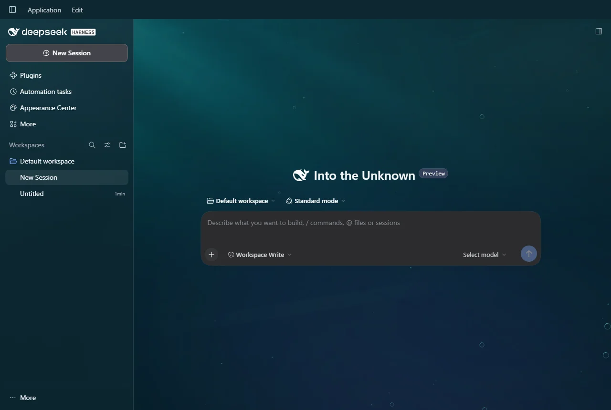
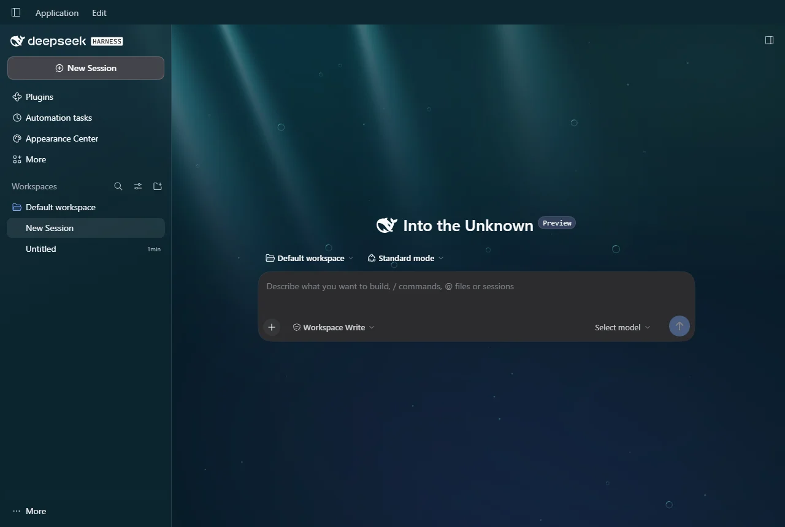

# Deep Ocean V2 · 动态光场

皮肤包 `0.2.0` 使用 Engine API `^1.9.0`。在外观中心更新已安装的「深海光境」ZIP，再到「效果与性能」调整深海光场的光强、光束长度和漂移。亮度归零后，气泡与浮尘仍可独立显示。低画质使用两束静止的光，平衡与高画质分别最多绘制四束和五束。

## Windows Desktop 实拍

官方 DSH `0.2.2-rc.5`，隔离配置，1280 × 860 CSS 像素。将 Alpha 在同一窗口原地更新，均使用皮肤默认值。两次实拍均只有一份共享特效画布。Alpha 加载了一张 1672 × 941 的光束底图，候选版由程序计算光束，未加载底图。另在含代码的会话内输入并检查滚动。测试窗口已退出。

| Alpha 0.1.0 | 动态光场 0.2.0 |
| --- | --- |
|  |  |

[正文和输入框实拍](images/o-v2-02/reading.webp)
