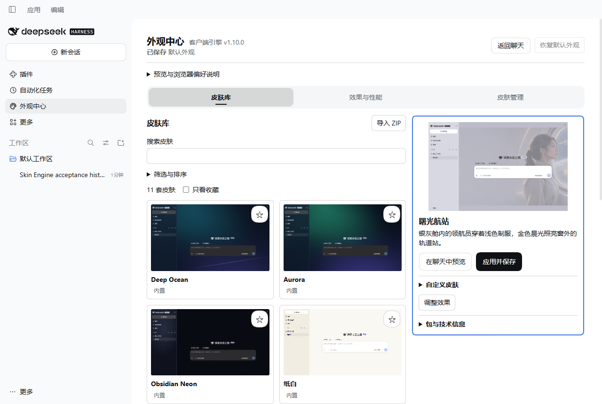
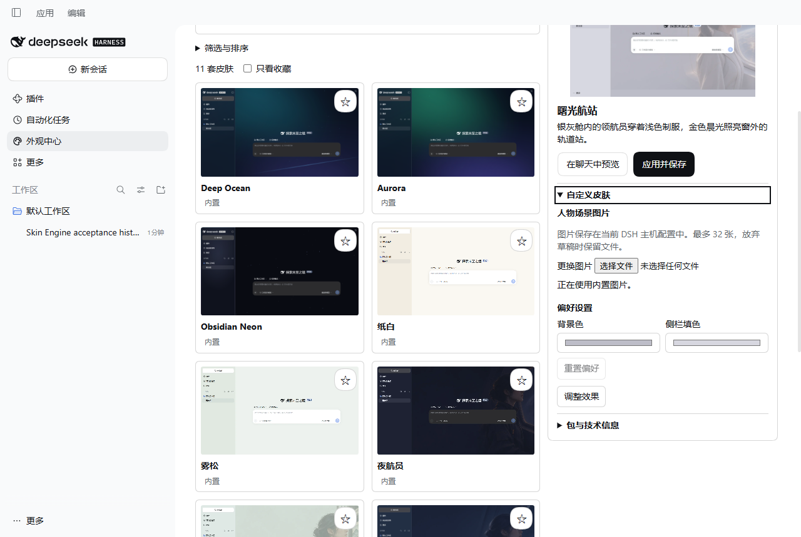

# DSH Skin Engine v1 安装与验收

## v1.11.0 个人图片与特效参数

本版使用 **Engine API 1.7.0**，支持 **DSH 0.2.2-rc.1 或更新版本**。下载 `dsh-plugin-skin-engine-1.11.0.tgz` 和 `SHA256SUMS.txt`，校验后安装。升级前请退出 DSH 并备份配置。 [v1.11.0 下载](https://github.com/Activer007/dsh-skin-engine/releases/tag/v1.11.0) · [安装与启用](#安装与启用)

- **个人图片管理。** 在「外观中心 → 皮肤管理」查看图片容量、缩略图和保存引用，经确认后删除可移除的图片。 [PR #8](https://github.com/Activer007/dsh-skin-engine/pull/8)
- **声明式人物换图。** 作者可在 Manifest 开启单张主图替换。旧 ZIP 和六款内置人物皮肤的已保存偏好继续可读。 [作者指南](user-artwork-stage1.md#为新皮肤开放单图替换) · [PR #9](https://github.com/Activer007/dsh-skin-engine/pull/9)
- **统一特效参数。** 校验、偏好和设置控件共用描述，保留旧特效文件与已保存的范围、单位和数值。 [PR #10](https://github.com/Activer007/dsh-skin-engine/pull/10)

发行页还提供「浮光深境 VI」和支持声明式换图的浅色人物作者模板。下载对应的 `.dshskin.zip` 后，在「外观中心 → 皮肤库 → 导入 ZIP」导入。

## v1.10.3 侧栏与深海动效

- **动效可延伸到侧栏。** 在 DSH 的「设置 → 皮肤引擎 → 窗口特效」打开侧栏动态效果。已有会话的输入框底部与皮肤背景自然衔接。
- **Aurora 1.1.0。** 极光亮度、变化幅度和速度可以独立调整，固定星光轻微闪烁，并可单独关闭。
- **浮光深境 VI 1.2.0。** 独立 ZIP 提供整体亮度、深海光束、浮尘和气泡调节。README 的实拍先展示浮光深境 VI，再展示 Deep Ocean 的高密度粒子与液态折射。 [实拍演示](../README.md)

从 GitHub Releases 下载 `dsh-plugin-skin-engine-1.10.3.tgz` 和 `SHA256SUMS.txt`，校验后安装引擎。引擎包含 11 款内置皮肤，使用 Engine API 1.6.0，需要 DSH 0.2.2-rc.1 或更新版本。要启用浮光深境 VI，下载同页的 `com.dsh.skin.deep-ocean-living-light.dshskin.zip`，在「外观中心 → 皮肤库 → 导入 ZIP」导入。 [下载与校验文件](https://github.com/Activer007/dsh-skin-engine/releases) · [安装与启用](#安装与启用)

## v1.10.1 公开仓库首版

保留 v1.10.0 的外观中心、11 款内置皮肤、人物换图和聊天预览。公开仓库保留 30 项里程碑，源码使用 MIT 许可证。本版本重新构建了安装包，请使用本版的 SHA-256 校验文件。

[项目沿革](history.md) · [安装与启用](#安装与启用)

## v1.10.0 新版外观中心

- **画廊更好逛。** 大卡片适合看图，星标可直接收藏。搜索和「只看收藏」常驻，标签、来源、排序与兼容性选项按需展开。
- **预览和保存更好找。** 皮肤详情与特效页把「在聊天中预览」和「应用并保存」放到前面。折叠自定义、切换页签或取消聊天预览后，未应用的草稿可以继续编辑。
- **内置皮肤调整为 11 款。** 「晨光温室」和「雨夜列车」退出内置皮肤库，人物换图仍覆盖六款皮肤。「晨光温室 · 场景版」仍可作为独立作者样例导入。
- 原来使用这两款皮肤的用户在升级后会看到 DSH 默认外观，可从画廊重新选择。原有偏好和图片仍保存在本地。





[曙光航站的新会话截图](images/v1.10.0/dawn-station-chat.png) · [安装与启用](#安装与启用) · [回滚](#回滚)

## v1.9.3 人物皮肤换图

- 八款内置人物皮肤可替换单张图片，支持适应／填充、位置、缩放、不透明度和恢复内置图。缺图时显示内置图，仍可保存其他偏好。 [人物换图说明](user-artwork-stage1.md)
- 聊天预览显示 30 秒倒计时。主动取消会返回外观中心原页签并保留草稿，自然到期会留在聊天并恢复保存的皮肤。三页签增加选中标识、悬停底色与键盘焦点。
- 私人图片按 Profile 存储并按内容去重。每个 Profile 最多 32 张，每张 5 MiB。恢复默认保留文件，目前没有清理界面。ZIP 导出排除私人图片及其引用。

升级前备份目标 Profile、原版安装包和选择文件，已有私人图片时一并备份 `skin-engine-user-artwork/`。安装后在外观中心确认 Client 版本，也可从「设置 → 皮肤引擎」检查 Host。回装不支持私人图片的旧版时，使用升级前备份的选择文件。 [安装命令](../README.md#安装) · [回滚步骤](#回滚)

Windows Desktop `0.2.2-rc.3` 已验证深色横图、浅色竖图、缺图回退、恢复默认和重启保留。本机也已从 1.9.2 原地升级并确认现有皮肤、偏好和换图入口。聊天预览和页签改进在官方 Web 与 Windows Desktop 均有专项记录。人物换图的 Web 专项仍待验证。 [人物换图验收](user-artwork-stage1-validation.md) · 预览 PR (archived PR #60) · 页签 PR (archived PR #61)

## v1.9.1 R1 发行

- 从 v1.8.2 升级后，皮肤库、皮肤特效和 ZIP 操作从左侧「外观中心」进入。画廊支持收藏、最近应用及排序。打开「在聊天中预览」后，可以在真实聊天中试用约 30 秒。
- 「设置 → 皮肤引擎」保留窗口效果、诊断和紧急恢复。外观中心和设置页均可二次确认恢复默认外观，皮肤包与各皮肤偏好会保留。
- 插件、Client 和 Host 版本为 1.9.1。皮肤声明的 Engine API 为 1.4.0，最低 DSH 版本为 0.2.2-rc.1。 [官方宿主实测范围](dsh-compatibility.md)
- Worktable 和 Wallpaper Engine 的真实共存暂缓。历史 NAV-06 验收矩阵、例外与失败记录继续保留。 [NAV-06 证据](navigation-release-guide.md#证据索引与门禁命令)

原地升级前退出目标 Profile，备份当前插件归档、Profile 插件配置、皮肤包及选择文件。按 [README 安装命令](../README.md) 用 1.9.1 归档替换并重启，在 DSH 插件详情核对安装版本，从「设置 → 皮肤引擎 → 诊断」核对 Client 和 Host 版本。随后进入外观中心核对已应用的皮肤、偏好与本地 ZIP。

回装到 1.8.2 时，退出同一 Profile，用相同安装命令换回已校验的 1.8.2 归档，再打开原 Profile 从旧设置图库核对保存状态与本地 ZIP。升级前备份可用于手动恢复损坏或缺失的选择、包目录及配置。回装比 1.8.2 更早的版本时，按对应版本的存储兼容说明处理。 [完整回滚说明](#回滚)

包含新版 README 的构建候选为 `879c38d1a6cfae47a921d208fe08c5469b97cba1`。在 Windows x64、Node 24.16.0、npm 12.2.1 上从两份独立 LF 检出运行 `verify:local`，构建、类型检查、Lint、106 项测试通过，27 份归档逐字节一致。`dsh-plugin-skin-engine-1.9.1.tgz` 为 1,474,638 字节，SHA-256 为 `dcc7e0a1b982dc5983a31a1c6a4ee802321ac6fdeb5c9fc8b965b9affdee0865`。与首轮归档相比，83 个文件中只有 README 内容变化。后续证据提交只更新位于归档之外的 `docs/release-v1.md`。 [本地复建命令](local-verification.md)

官方 DSH `0.2.2-rc.3` Web 和 Windows Desktop 使用这一份 1.9.1 归档及正式 v1.8.2 归档（SHA-256 `2073d38119ddd217c384d3d1c0802b7a09113871fa0a2475165954b1470924db`）。每端在同一 Profile 依次运行 1.8.2、1.9.1、1.8.2。升级后 Deep Ocean、修订 1、`low` 偏好及导入的 ZIP 均保留。从 1.9.1 外观中心保存 `high` 后，回装的 1.8.2 读取修订 2 并在旧设置页显示新偏好。三个阶段的 Client 与 Host 版本一致，导入包 ID、版本及修订一致。两个隔离宿主与浏览器均已关闭。 [复跑命令](acceptance.md#运行)

最终归档的 LHA 证据分别在 `.cache/r1/rel02/final-host/web-VYwmIb/` 和 `.cache/r1/rel02/final-host/desktop-Qyvfk9/`，含 `result.json`、`previous-diagnostics.png`、`upgraded-diagnostics.png`、`rolledBack-diagnostics.png` 和 `upgraded-appearance-center.png`。三个插件阶段均无未捕获页面异常。Windows 在测试插件安装前记录了 `ECONNRESET` 和同一次启动的 `dsh-desktop:boot` 错误，原始日志在该报告目录下的 `electron-user-data/logs/`。安装后的三个插件阶段均通过，控制台 `net::ERR_FAILED` 记录保留在报告中。

首轮归档来自 `21c6e5a1b4295bbabfc89a9e6e75e6d40024d2fd`，SHA-256 为 `b87b02f6fa339d5ae0a772645b33591feb03690790a5d34b8c37e58cbe817872`。其原始结果保留在 `.cache/r1/rel02/host/web-7Vwu1w/` 和 `.cache/r1/rel02/host/desktop-f6Ar88/`。首轮 Windows 在安装测试插件前的启动阶段记录了一次 `ECONNRESET`，三个插件版本阶段随后均通过。R1 发行范围以官方宿主的验证为准。历史 NAV-06 的 rc.1 性能和后台采样继续引用原候选。 [兼容记录](dsh-compatibility.md) · [NAV-06 实测](navigation-release-guide.md)

## v1.5 应用皮肤时切换 DSH 外观

在 Skin Engine 点击「Apply」时，若皮肤声明的明暗与当前 DSH 外观不同，引擎会通过 DSH 原生主题服务切换到对应外观，并保存皮肤。应用失败时恢复原外观。当前外观已经匹配、皮肤支持双模式或未指定模式时，沿用当前 DSH 设置。

「Preview」仍为当前窗口的临时预览。跨明暗时，详情页提示用「Apply」切换。恢复 Default 会撤掉皮肤，显示当前的 DSH 原生外观。应用后也可在「通用设置」手动调整外观，皮肤在外观匹配时重新生效。

Windows Desktop 的既有专项和 NEXT-01 的 Web 专项使用同一份 v1.5.0 tarball。Web 已通过双向跨明暗、预览取消、409 恢复、宿主重启和 Default 验收。 [Web 复跑与证据](acceptance.md#v150-web-外观专项-next-01) · Desktop 专项 (archived PR #17)

## v1.4 人物续集

按四张附件的顺序新增「蓝弧远航」「曙光航站」「月窗余晖」「绯雨霓虹」。曙光航站适用浅色外观，其余三款适用深色。插画等比显示，沿用原图右侧人物和对话区留白。画廊共有十三款内置皮肤，其中八款可通过 `character` 标签筛选。新版安装包名为 `dsh-plugin-skin-engine-1.4.0.tgz`。 [附件与皮肤对应关系](release-asset-notes.md#v14-人物续集) · [安装与启用](#安装与启用)

官方 DSH Web `0.2.2-rc.1` 隔离会话逐一验证四款皮肤的应用、插画解码、画布和侧栏配色。切换明暗模式时核对回退，恢复 Default 后确认插画卸载。最终包的运行时和四张插画与实测包逐字节一致，另附四张实拍缩略图。安装包大小为 1 421 689 字节，SHA-256 为 `fce5f740afcebcf9e90882f5356eea1500da0fd8f07b879220384cce052d8335`。

## v1.3 原创人物系列

以「夜航员」为同一人物增加三款内置皮肤。浅色的「晨光温室」采用暖象牙色、水彩、长辫和野外工作服。浅色的「青玉书库」采用灰青色、版画笔触、发髻和立领亚麻衣。深色的「雨夜列车」采用深梅灰色、夜雨反光、披发和雨衣。画面把人物放在右侧，左边与中部采用低对比背景。三款均使用随包静态插画。 [素材与生成提示](release-asset-notes.md#v13-人物系列)

画廊共有九款内置皮肤，其中四款可用 `character` 标签筛选。应用前在 DSH「通用设置」切到对应的浅色或深色外观。引擎安装包名为 `dsh-plugin-skin-engine-1.3.0.tgz`。 [安装与启用](#安装与启用)

官方 DSH Web `0.2.2-rc.1` 隔离会话核对了三款皮肤的应用、明暗切换、图片解码、实际画布与侧栏颜色，以及恢复 Default 后卸载插画。三款均以 `contain` 呈现静态图，没有创建效果 Canvas。最终包内的运行时和插画与各自的验收包逐字节一致，另附三张实拍缩略图。安装包大小为 1 101 095 字节，SHA-256 为 `a63ae424116014d5b25d90f5b493669c30ee695a88f44885cb4d96f3e716b372`。

## v1.2 内置画廊扩充

内置皮肤从四套增至六套。新增浅色静态皮肤「雾松」和深色人物皮肤「夜航员」。夜航员使用本地 WebP 插画和静态画布，窄窗采用等比完整显示。静墨和暖暮继续使用各自的独立 ZIP 和原有 ID。设置页打开时默认展开 Customize skin、Window effects、Maintenance and diagnostics。页首的 Client engine 显示当前加载的引擎版本，皮肤详情中的 Skin package 显示选中皮肤自己的版本。

从 v1.2.0 对应源码执行 `npm pack` 打包引擎，执行 `npm run pack:samples -- <输出目录>` 可打包六份对应的演示 ZIP。Windows Desktop 原地升级见 [安装与启用](#安装与启用)，将命令里的包路径指向 `dsh-plugin-skin-engine-1.2.0.tgz`。

发行 tarball 为 828 591 字节，SHA-256 为 `152bbe2a2a9f92fbef74695da9140771bda82d772ed556d1305014a0c601de95`。官方 DSH Web `0.2.2-rc.1` 专项验收核对了六套内置皮肤、人物标签、夜航员的图片解码与静态渲染、雾松的实际画布及侧栏配色，以及恢复 Default。缩略图取自这轮验收使用的隔离会话。Windows Desktop 使用发行 tarball，在隔离配置中复验相同行为、两套缩略图的解码和三个区域默认展开，结束后关闭夹具。 [素材记录](release-asset-notes.md)

## v1.1.0 发布基线

**v1.1.0** 在官方 DSH `0.2.2-rc.1` 的 Web 和 Windows Desktop 隔离配置中完成发布回归。最终 tarball 位于 `.cache/v1.1.0/final/artifacts/`，SHA-256 为 `5133d984e3f38c4a66757153c868ad5a110f3a6b87a6f6379fbd790a14936fa5`。同目录的 `SHA256SUMS.txt` 记录引擎和七份 ZIP。v1.0.4 保留为宿主适配基线，v1.0.3 一节记录实际 Windows Desktop 配置的安装验证。 [v1.1.0 发布回归](acceptance.md#v110-发布回归) · [v1.0.4 发布回归](acceptance.md#v104-发布回归记录) · [后续任务](development-roadmap.md#后续任务)

## v1.1 样例与本地更新

纸白是浅色静态皮肤，使用暖白画布和浅暖灰侧栏。切换到深色后采用 DSH 原生深色，保存的纸白选择继续保留。返回浅色时恢复纸白。运行 `npm run pack:samples -- <输出目录>` 生成包括 `paper-light.dshskin.zip` 在内的四个内置样例 ZIP。纸白的内置 ID 为 `com.dsh.skin.paper-light`，配套 ZIP 使用 `com.dsh.skin.paper-light.sample`，两者皮肤包版本均为 `1.0.0`。 [静态样例验收](acceptance.md#纸白样例验收) · [预览素材](release-asset-notes.md)

静墨和暖暮是深色独立样例。按 [样例源码说明](../skin-sources/examples/README.md) 用 `pack:skin` 生成两个 ZIP，然后在「设置 → Skin Engine → Import ZIP」分别导入。静墨采用石墨色静态外观，暖暮采用暖棕画布和低强度边缘流光。 [静墨与暖暮验收](acceptance.md#静墨与暖暮样例验收)

已导入的本地皮肤可在详情页展开「Package actions」，通过「Update ZIP」选择同 ID 的较新版本。更新成功后，使用「Roll back to v…」及确认按钮回到上一版。画廊保留皮肤选择与保存偏好。 [本地更新与回滚验收](acceptance.md#本地更新与回滚验收)

### 重建发行产物

当前分支的候选包可按本地校验流程从锁定提交打包，并用第二份独立检出复核 SHA-256。以下命令保留用于复现 v1.1.0 的历史产物。 [本地校验](local-verification.md)

在独立工作树以 LF 换行检出 `56d1f51`，使用 Node.js 24.16.0、npm 12.2.1 和仓库锁文件重建。可通过 `git -c core.autocrlf=false worktree add --detach <路径> 56d1f51` 创建工作树。以下命令在该工作树根目录运行。输出包含引擎 tarball、四个内置皮肤对应的 `.sample` ZIP、两个独立样例 ZIP 和 Starter ZIP。作者可继续复制 Starter 源码再改用自己的 ID。 [作者模板](../skin-sources/examples/templates/starter/README.md)

```powershell
npm ci
if ($LASTEXITCODE) { throw 'Dependency installation failed' }
$out = '.cache/v1.1.0/final/artifacts'
New-Item -ItemType Directory -Force -Path $out | Out-Null
npm pack --pack-destination $out
if ($LASTEXITCODE) { throw 'Engine packaging failed' }
npm run pack:samples -- $out
if ($LASTEXITCODE) { throw 'Built-in sample packaging failed' }
$examples = 'DSH_Skin_Engine_Development_Pack_v1.0/examples'
foreach ($source in 'skins/ink-focus','skins/warm-dusk','templates/starter') {
  npm run pack:skin -- "$examples/$source" $out
  if ($LASTEXITCODE) { throw "Failed to package $source" }
}
Get-ChildItem $out -File |
  Where-Object { $_.Name -match '\.(tgz|zip)$' } |
  Sort-Object Name |
  ForEach-Object {
    '{0}  {1}' -f (Get-FileHash -LiteralPath $_.FullName).Hash.ToLowerInvariant(), $_.Name
  } | Set-Content "$out/SHA256SUMS.txt" -Encoding ascii
```

## v1.0.4 运行版本标记

设置页标题旁的 `Client engine v1.0.4` 来自实际运行的 Client。展开 `Maintenance and diagnostics` 后点击 `Check Host`，可以核对正在运行的 Host 引擎版本。两端版本不同会提示重启方式。皮肤详情分别显示 `Skin package v1.0.0` 和 `Engine API ^1.0.0`，分别对应皮肤清单的版本和兼容范围。DSH「插件」详情继续显示已安装的插件版本。 [原地升级验收命令](acceptance.md#运行)

2026-11-10 在官方 Windows Desktop `0.2.2-rc.1` 的隔离配置中，将 v1.0.0 原地升级到 v1.0.4。重新打开后，Client 和 Host 均显示 v1.0.4，Deep Ocean 仍为已应用，保存修订号为 1，`low` 质量偏好保持。另通过模拟诊断响应核对版本不一致、旧 Host 缺少版本和 HTTP 503 三种提示。原始记录为 `.cache/pr-16/desktop-WZcwI4/result.json`。

候选包位于 `.cache/pr-16/artifacts/dsh-plugin-skin-engine-1.0.4.tgz`，SHA-256 为 `74be9d217f1e845fdac99d689700ac7eb335a18a3e93d84bd3a504f0a9817f18`。此轮验证使用隔离配置，实际桌面环境的已安装版本为 v1.0.3。

## v1.0.4 宿主表面适配

PR-17 候选包位于 `.cache/pr-17/artifacts/dsh-plugin-skin-engine-1.0.4.tgz`，SHA-256 为 `a9daa2c97907019bc5d28fecfe9497fbc0149bc1ee4176b596242e903829d39c`。官方 Web 和 Windows Desktop 以该包复跑设置弹窗、会话输入卡片、系统回退与停用清理。两端还完成了 ZIP 往返、10/100 包目录、100 次保存切换、300 秒原生后台暂停恢复及配对性能。 [宿主表面证据](acceptance.md#v104-宿主表面记录) · [发布回归记录](acceptance.md#v104-发布回归记录)

## v1.0.3 设置面板整理

宽窗并排显示皮肤画廊和当前皮肤详情。预览、应用与实际状态靠近选中皮肤，细项、窗口效果、包操作和诊断按需展开。窄窗按画廊、详情和工具的顺序纵向排布。

仅打开 Skin Engine 页时，设置弹窗目标宽度由 800 增至 1120 CSS 像素，仍受宿主视口上限约束。切换设置页时恢复宿主原尺寸。安装包与校验清单位于 `.cache/pr-14/manager-layout-final/`。

官方 Web 和 Windows Desktop 实测 1280 像素视口下宽度为 1120，离开该页回到 800。520 像素视口下两端均无横向溢出。已验证键盘预览与取消、保存偏好、宿主诊断和 ZIP 导入与卸载。深色 Apply 按钮的常态和悬停对比度分别约为 18.1:1 和 16.2:1。类型检查、lint 和 35 项测试通过。截图及采样位于 `.cache/pr-14/`。

v1.0.3 的 tarball SHA-256 为 `090c688b78f961603d3d96bb7b740572ce1319a6fc8c6dc333b0947d188438bb`。三套样板可从同一源码用 `npm run pack:samples` 生成。已在 Windows Desktop 的隔离配置和实际桌面配置通过内置 CLI 从 v1.0.0 原地替换。实际桌面配置已核对插件版本、启用状态、安装 Client 哈希及原保存选择，并完成宿主重启。

设置页右侧 `Deep Ocean` 详情中的 `DSH Skin Engine · v1.0.0` 来自该皮肤清单的作者和皮肤版本。设置页底部的 `Engine API ^1.0.0` 是皮肤声明的兼容范围。v1.0.3 的插件版本可在 DSH「插件」列表的 Skin Engine 详情中查看，也可核对 Desktop profile 下 `node_modules/dsh-plugin-skin-engine/package.json` 的 `version`。 [候选包的版本标记](#v104-运行版本标记)

## v1.0.2 Deep Ocean 外观微调

会话输入框的原生底色以 82% 不透明度混合，仅作用于内置 Deep Ocean 和同名 ZIP 样板的会话输入框。系统减少透明度或强制颜色时保留原生底色。浮尘提高亮度、尺寸和漂移速度，Balanced 实测仍绘制 56 粒子。

在官方 Windows Desktop 对照 v1.0.1 和 v1.0.2，验证升级保留皮肤选择、输入可编辑、恢复 Default 后底色复原。Web 也通过输入、透明度及 Default 恢复检查。截图与采样位于 `.cache/pr-13/` 的 `deep-ocean-before`、`deep-ocean-after` 和 `deep-ocean-web-after`。类型检查、lint 和 35 项测试通过。安装包与校验清单位于 `.cache/pr-13/deep-ocean-visual/`。

## v1.0.1 应用提示修订

不匹配的外观模式会在 Preview 和 Apply 按钮旁显示切换步骤，并停用这两个操作。成功应用后在同一位置确认状态。两端实测 Aurora 的浅色提示、深色预览不落盘、应用后保存、切回浅色保留选择及返回深色自动恢复。类型检查、lint 和 35 项测试通过。证据位于 `.cache/pr-12/` 下的 `web-appearance-feedback.json` 和 `desktop-appearance-feedback.json`。

修订包为 `.cache/pr-12/appearance-feedback/dsh-plugin-skin-engine-1.0.1.tgz`，SHA-256 为 `1a9d43c3788d0b3a4286f0dced48de55e10c68bbbaa20e78c2ad5504fff94035`。

## 构建与校验

在仓库根目录使用 Node.js 24.9 或更新版本，安装锁定依赖后构建。

```powershell
npm ci
npm run typecheck
npm run lint
npm test
$output = '.cache/release-v1'
New-Item -ItemType Directory -Path $output -Force | Out-Null
npm pack --pack-destination $output
npm run pack:samples -- $output
Get-ChildItem $output -File | Where-Object { $_.Name -match '\.(tgz|zip)$' } |
  Sort-Object Name | ForEach-Object {
    '{0}  {1}' -f (Get-FileHash $_.FullName -Algorithm SHA256).Hash.ToLowerInvariant(), $_.Name
  } | Set-Content -Encoding ascii "$output/SHA256SUMS.txt"
```

极光缓存候选包、三套样板及 `SHA256SUMS.txt` 位于 `.cache/pr-11/aurora-candidate/`。最终复验重新构建并打包，四份产物的 SHA-256 均与该清单一致。前几轮的产物保存在 `.cache/pr-11/` 下的 `sidebar-candidate/`、`performance-candidate/` 和 `release/`。预览来源和许可见 [素材与许可](release-asset-notes.md)。

## 安装与启用

**Web** 使用 DSH CLI 在目标 profile 安装预构建的 `.tgz`。`web` 可替换成已存在且包含 Web 应用的自定义 profile 名称。将示例的绝对路径替换为实际产物路径。

```powershell
dsh plugin --profile web add -w file:E:/path/to/dsh-plugin-skin-engine-1.1.0.tgz
dsh --profile web
```

若目标 Web profile 正在运行，完成安装后重启它，再打开本次启动的访问地址。

**Windows Desktop** 由 Electron 管理 `desktop` profile 的插件。在全局「插件」面板选择「安装第三方插件」，将 `.tgz` 的绝对路径粘贴到「包名或地址」。安装后选择「立即启用」，重新启动 Desktop，再从左侧打开「外观中心」。

**Windows Desktop 原地升级** 从「应用 → 退出」完全退出 Desktop，然后调用该安装自带的 CLI。用本机 Desktop 安装路径及目标 tarball 的绝对路径替换示例。命令完成后重新打开应用，在「插件」详情核对 `dsh-plugin-skin-engine` 的版本及启用状态。外观中心标题旁显示客户端引擎版本，皮肤包版本可在详情的「包与技术信息」里查看。 [DSH 内置命令](https://github.com/deepseek-ai/deepseek-harness/blob/dsh-v0.2.2-rc.1/apps/desktop/README.zh.md#bundled-command-runtime)

```powershell
& '<local-path>/deepseek-harness/resources/runtime/cli/bin/dsh.cmd' plugin --profile desktop add 'file:E:/path/to/dsh-plugin-skin-engine-1.1.0.tgz'
```

**皮肤样板** 在「设置 → Skin Engine → Import ZIP」选择[六套样例](#v11-样例与本地更新)中的一个 ZIP。纸白使用浅色模式，其余五套使用深色模式。内置皮肤对应的导入样例卡片带 `(ZIP Sample)`，静墨与暖暮直接显示其名称。点击 `Preview` 或 `Apply`。颜色模式不匹配时采用 DSH 原生外观并保留已保存选择。卸载时打开 `Package actions` 并确认 `Uninstall…`，卸载活动样例后回到 Default。

## 回滚

1. 升级前退出目标 profile。备份原版插件包、目标 profile 的插件配置和 `<profile>/skin-engine/`，以及 `DSH_HOME/storages` 下属于该 profile 的 `skin_engine_selection_<hash>.json`。文件名的 hash 是 profile 真实绝对路径的 SHA-256，Windows 先将路径转为小写。首次保存前可能没有这个文件。保持备份的文件名和存储位置记录，避免影响同一 `DSH_HOME` 下的其他 profile。
2. 回滚时退出目标 profile。Web 使用 `dsh plugin --profile web remove -w dsh-plugin-skin-engine`。Desktop 在全局「插件」面板停用并卸载 v1，随后退出。卸载操作后若宿主自动重载，再次确认 profile 已停止。
3. 将升级前备份的选择文件及需要恢复的包目录放回目标 profile 对应位置，然后按上述安装方式回装旧 `.tgz`。还原该插件原来的启用状态。v1 写入 v4 选择存储，回装只支持旧存储格式的版本时使用升级前的选择备份。若已通过 v1.1 更新过本地皮肤包，同时还原升级前备份的完整 `skin-engine/` 目录。
4. 启动原 profile，从设置页核对已保存的主题和偏好。若恢复了导入包目录，同时核对相应卡片。仅恢复默认外观时，可在设置页应用 Default，或通过插件面板停用引擎。

从 1.8.2 回装 1.8.1 时，如果曾保存 `ambient.light` 偏好，1.8.1 的选择服务会返回 `503 selection-unavailable`。即使先在 1.8.2 应用 Default，按皮肤保存的偏好仍会留在选择记录。按上述步骤恢复升级前的选择备份，再从 1.8.1 核对旧偏好与 Default。 [Desktop 回装验证](effects-runtime.md#ui-01-环境光偏好验收)

## 候选包复验进度

| 项目 | Web · 官方 DSH `0.2.2-rc.1` | Windows Desktop · 官方 DSH `0.2.2-rc.1` |
| --- | --- | --- |
| 预构建包安装 | CLI 在全新 profile 安装并启动。 | 在原生插件面板安装并启用，重启后可用。 |
| 三套 ZIP 样板 | 全部通过导入、预览取消、应用、浅色回退、回深色恢复和活动包卸载。 | 同左。Obsidian Neon 另在已有保存选择的会话中复验可信点击涟漪，随后完成回退和卸载。 |
| 目录元数据 | 本地 10 和 100 个有效 manifest，各请求 5 次。含 3 个内置包，分别为 127–145 ms 和 704–884 ms。夹具只提供 manifest，扫描确认无目录问题。 | 同样本量分别为 104–289 ms 和 616–2163 ms。100 包中首请求为 2163 ms，其余为 616–650 ms。 |
| 100 次切换 | 通过。最终候选包在 35.2 秒内完成 50 组预览与取消。活动时有一个 Canvas，撤回后装饰与标记归零，CDP 检查的引擎监听器回到基线。 | 通过。38.0 秒完成相同检查。 |
| 插件启停与重装 | 通过。停用后路由返回 404，皮肤作用域和渲染资源清空。重新启用后，路由和保存的皮肤恢复。卸载与重装覆盖于下列回滚检查。 | 通过相同热启停检查。另经原生插件面板卸载并回装最终候选包，完整重启 Desktop 后，保存的皮肤和偏好恢复。 |
| 旧包升级和回装 | 从 `0.0.8-p1.0` 升到 v1，保留原选择和偏好。写入 v4 后卸载，路由返回 404。恢复 v3 快照并回装旧包后，原选择和偏好逐值一致。 | 通过原生插件面板卸载和换包，按相同版本顺序实测。每次换包后重启，卸载路由返回 404，回装后原选择和偏好逐值一致。 |
| 参考插件共存 | Wallpaper Engine `1.4.2`、Maid Atelier `0.1.10` 已实装。双插件及各自启用时，皮肤引擎保留保存值并撤回自己的外观。壁纸连续轮播，玻璃状态保留。清空壁纸并重新打开页面后，原皮肤自动恢复。 | 通过原生面板实装相同版本。双插件和仅壁纸两种状态均持续轮播。清空壁纸并重启后恢复保存的 Obsidian Neon，重新启用 Maid 后再次让路，保存值和参考插件设置一致。 |
| 五分钟后台暂停 | 通过原生 Chrome 标签页切换触发 `hidden` 和 `visible`。300 秒期间停止绘制并释放 Canvas 缓冲和极光图像，恢复后沿用同一 Canvas，首笔粒子坐标不变。 | 在隔离测试进程中关闭 Windows 自动遮挡检测，由 Electron 最小化、隐藏及还原真实窗口。300 秒期间停止绘制并释放 Canvas 缓冲和极光图像。还原后连续 5 秒保持可见，两层极光缓存、三条 CSS 动画和 Canvas 绘制均恢复。 |
| 安全 | 未认证目录返回 401，跨站写入及导入返回 403。路径穿越、符号链接、大小写冲突、CRC 错误、ZIP 炸弹、越界 CSS、未声明脚本及伪造或超限图片均拒绝。上传 512 KiB 后取消，暂存清空。 | 通过 `dsh-app://app/` 重验同一组 ZIP 安全负例，上传 512 KiB 后取消并清空暂存。真实导入请求正常返回 201，注入外站 `Origin` 后返回 403 且无暂存，清除后再次返回 201。 |
| 性能 | 通过。极光缓存候选包的完整对照中，P0 相对 Default 的帧间隔、输入和侧栏 P95 增量均在 16.7 ms 排查线内。 | 通过。正常启动下，三轮三状态对照均在 16.7 ms 排查线内。此前一次混合对照的输入和侧栏超线未再复现。 |

两端样板均解码了 1280 像素宽的包内预览。目录规模、安全和旧版回滚使用首轮 v1 的 Host 验证，与最终候选包内的 Host 逐字节一致。对应记录位于 `.cache/pr-11/`，文件名分别以 `-release-catalogue.json`、`-release-security.json` 和 `-release-rollback.json` 结尾。

### 八项效果

下表适用于 Web 和 Windows Desktop。两端都逐项验证开关和相应降级，极光缓存候选包在两端重验 P0 组合、可信点击涟漪及实际 WebGL 绘制。

| 效果 | 结果与实际验收 |
| --- | --- |
| Liquid Glass | 通过。玻璃跟随侧栏折展和窗口尺寸。侧栏收起或离开已知表面时撤回装饰，滤镜不可用时保留可读底色。 |
| Aurora | 通过。动态模式使用两层按视口生成的缓存图像，解码失败回退 CSS，减少动态效果时显示静态背景。 |
| Light Flow | 通过。边缘流光跟随已审计的侧栏位置，Reduced Motion 下停止动画。 |
| Floating Dust | 通过。复用 Canvas 2D，在后台停止绘制并释放缓冲，恢复时保持粒子位置。 |
| Click Ripple | 通过。真实点击触发涟漪并保留宿主点击行为。并发上限四个，减少动态效果时停用。 |
| Starfield | 通过。与浮尘共用画布及调度，静态模式保留一帧。 |
| Holographic Glass | 通过。指针只更新局部表面，减少动态效果时保留静态外观。 |
| Liquid Refraction | 通过。主动启用后实际绘制 WebGL，创建失败或上下文丢失时回退 CSS，恢复时重建 GPU 资源。 |

独立效果及故障夹具见 [P0 CSS](development-roadmap.md#pr-05-css-效果验收)、[浮尘](development-roadmap.md#pr-06-浮尘与性能基线)、[P1 效果](development-roadmap.md#pr-09-p1-效果验收) 和 [折射与 Auto](development-roadmap.md#pr-10-折射与自动质量验收)。

Web 和 Desktop 均通过官方 Host 的连接服务构造实际非 owner peer。目录、详情、预览 GET/HEAD、保存选择、应用、导入、导出、卸载九项均返回 403。owner 对照正常读取，空写入请求返回参数或媒体类型错误。证据位于 `.cache/pr-11/` 的 `skin-engine-v1-release-owner.json`、`desktop-release-owner.json` 和 `desktop-release-origin.json`。

同一份 Deep Ocean 样板分别导入两个 profile。各自的 owner 用本 profile 的修订号读取详情和预览 GET/HEAD 均返回 200，预览类型为 `image/png`。交换修订号后，三项读取均返回 404。测试后分别卸载了样板。证据位于 `.cache/pr-11/cross-profile-release-asset.json`。

两端以 Wallpaper Engine 的 2.5 秒测试间隔验证被动让路。v1 保留活动壁纸和旧皮肤的所有权，使用自身作用域记录活动皮肤。Wallpaper Engine `1.4.2` 在收到外部主动让路信号后有轮播计时器复位问题。详细边界见 [宿主审计](host-audit.md#t5-01a-参考插件共存)。共存证据位于 `.cache/pr-11/` 的 `web-release-interop.json` 和 `desktop-release-interop.json`。

后台采样证据为 `.cache/pr-11/` 的 `web-release-native-cycle.json`、`desktop-release-native-hidden.json` 和 `desktop-release-native-resume.json`。

### 性能复验

Web 使用 Chrome、1280 × 900，Desktop 使用 1279 × 820。两端均为 DPR 2，并在各自的同一个空白会话采样。在每种状态下先采集 360 个空闲帧间隔，再执行 12 组输入和侧栏折展。静态主题保留 Deep Ocean 的外观并将效果设置为 Off。输入和侧栏延迟采用可信事件至下一帧回调的时间。长任务涵盖整轮采样。

| 宿主 · 状态 | 空闲帧间隔 P95 ms | 输入 P95 ms | 侧栏 P95 ms | 长任务数 | JS 堆 MiB | 效果节点 | 空闲绘制 FPS |
| --- | ---: | ---: | ---: | ---: | ---: | ---: | ---: |
| Web · Default | 16.9 | 108.5 | 100.0 | 33 | 41.18 | 0 | 0 |
| Web · 静态 Deep Ocean | 16.9 | 112.2 | 81.4 | 34 | 44.21 | 5 | 0 |
| Web · Balanced 四项 P0 | 16.9 | 128.7 | 110.8 | 47 | 43.75 | 5 | 25.8 |
| Desktop · Default | 16.9 | 113.4 | 90.9 | 22 | 44.11 | 0 | 0 |
| Desktop · 静态 Deep Ocean | 16.9 | 93.7 | 68.9 | 22 | 46.21 | 5 | 0 |
| Desktop · Balanced 四项 P0 | 16.9 | 169.3 | 95.2 | 35 | 42.94 | 5 | 29.9 |

静态状态的 Canvas 缓冲为 0 × 0，Balanced 两端分别为 1920 × 1350 和 1918 × 1230。本轮两端 Default 均已有多次长任务。P0 输入 P95 比同轮 Default 分别高 20.2 ms 和 55.9 ms，超过 PR-06 的 16.7 ms 排查线。性能门槛待复测。原始数据在 `.cache/pr-11/` 的 `web-release-performance.json` 和 `desktop-release-performance.json`。

Web 另在全新性能 profile 中将输入和侧栏分段，执行 36 次输入与 24 次侧栏折展。两轮 Default 输入 P95 为 80.3 和 66.5 ms，静态为 78.9 ms，P0 为 90.1 ms。P0 的长任务为 58 个，两轮 Default 为 31 和 34 个。CDP 记录 P0 样本的样式重算耗时为 7811 ms，两轮 Default 为 6425 和 6577 ms。输入差值随 Default 波动，长任务和样式开销仍需排查。原始数据在 `.cache/pr-11/web-release-performance-recheck.json`。

Desktop 按相同分段方法复验。隔离窗口初次采样受系统后台限速影响，首轮 Default 的空闲帧间隔 P95 为 1016.7 ms，排除该轮。经宿主唤回后的静态、P0 和末轮 Default 空闲帧间隔 P95 均为 16.9 ms。P0 对比末轮 Default 的输入 P95 为 129.9 对 82.1 ms，侧栏 P95 为 97.2 对 67.2 ms，长任务为 115 对 47 个。性能排查继续以稳定可见窗口为前置。原始数据在 `.cache/pr-11/desktop-release-performance-recheck.json`。

Web 使用 GPU 合成开启的 Chrome `156.0.8078.80` 和 Intel Iris Xe。短追踪中，Default 与 P0 输入阶段各有 20 次同步样式读取，空闲阶段分别有 1 和 123 次 `UpdateLayoutTree`。保持 Canvas 运行并临时暂停 CSS 动画后，P0 的空闲样式更新从 124 次降到 2 次，Canvas 绘制从约 24.5 提升到 29.1 FPS。逐项关闭单个 P0 效果、替换关键帧中的变量、移除单项模糊或添加合成提示均未消除开销。临时夹具用于归因，性能门槛仍待复验。证据位于 `.cache/pr-11/` 的 `web-release-performance-ablation.json`、`web-release-performance-style-trace.json`、`web-release-performance-css-diagnostic.json` 和 `web-release-performance-composition.json`。

Desktop 在临时夹具中只暂停可信键盘或指针操作期间的环境 CSS 动画，并在最后一次操作 300 ms 后继续。输入 P95 为 88.0 ms，同轮两次 P0 为 147.1 和 109.3 ms，两次 Default 为 88.4 和 82.4 ms。Canvas 空闲绘制维持 29.9 FPS。侧栏延迟在各轮波动，需用性能修订候选包复验。证据为 `.cache/pr-11/desktop-release-performance-interaction-probe.json`。

### 性能修订候选包

性能修订在真实键盘和指针操作期间暂停环境 CSS 动画，保持当前画面，静默 300 ms 后续播。Canvas 和 WebGL 继续使用共享调度器。类型检查、lint 和 34 项测试通过。新 tarball 的 SHA-256 为 `3a44a1526b5a1a463eafc7bb582c1c9c8aea82ace366e9bb682639cf0df3e457`。两份 tarball 的差异为 `lib/client.js`，三套样板 ZIP 校验值相同。

Web 的 `skin-engine-v1-motion` 和 Windows Desktop 的 `desktop` 均装入新 tarball。两端安装后的 `lib/client.js` 与 tarball 逐字节一致。可信键盘和指针操作暂停三条 CSS 动画，Canvas 期间继续绘制，输入内容与侧栏操作正常。合成键盘事件经过时动画仍在运行。两端均验证了续播、Reduced Motion 和恢复 Default 后的装饰清理。证据位于 `.cache/pr-11/` 的 `motion-candidate-installed-client.json`、`web-motion-candidate-interaction.json` 和 `desktop-motion-candidate-interaction.json`。

| 宿主 | Default 输入 P95 两轮 ms | P0 输入 P95 ms | Default 侧栏 P95 两轮 ms | P0 侧栏 P95 ms | P0 空闲帧间隔 P95 ms | P0 空闲绘制 FPS |
| --- | ---: | ---: | ---: | ---: | ---: | ---: |
| Web | 66.6 / 74.8 | 79.1 | 54.5 / 55.9 | 74.2 | 16.9 | 23.4 |
| Desktop | 94.2 / 78.0 | 90.7 | 76.7 / 58.3 | 87.7 | 16.9 | 30.0 |

两端输入差值均在 16.7 ms 排查线内。侧栏仍有样本超线，继续做配对复测。Web 和 Desktop 的完整样本分别位于 `.cache/pr-11/web-motion-candidate-performance.json` 与 `.cache/pr-11/desktop-motion-candidate-performance.json`。

Web 单独复测侧栏，在同一 profile 交替运行三组 Default 和 P0，各状态每组折展 24 次。P0 的 P95 增量为 10.6、14.6 和 14.4 ms。证据为 `.cache/pr-11/web-motion-candidate-sidebar-pairs.json`。

Desktop 按相同方法得到 5.2、26.9 和 49.6 ms。每组 P0 布局耗时比同组 Default 多 202–275 ms。后两组超过排查线，继续定位折展时的表面重查开销。证据为 `.cache/pr-11/desktop-motion-candidate-sidebar-pairs.json`。

Desktop 的 24 次折展追踪中，表面重查回调耗时为 0.2–1.0 ms，每次属性变更都伴随结构记录。仅推迟属性变更的临时分支没有命中。下一轮验证 CSS 锚定和原生布局成本。证据为 `.cache/pr-11/desktop-motion-candidate-sidebar-observer.json`。

修订包的三套 ZIP 样板在两端均完成导入、预览取消、应用、浅色回退和卸载。两端在键盘触发交互暂停期间将真实窗口切入后台，300 秒期间 CSS 暂停且 Canvas 缓冲归零。Web 首轮取样发现恢复粒子坐标不一致。重载后用首笔实际绘制及 DOM 身份复验，同一 Canvas 保留，首笔粒子坐标一致。Desktop 经宿主唤回时视口由 1279 × 820 变为 1292 × 826，首帧粒子的相对坐标和半径一致。证据为 `.cache/pr-11/` 的 `web-motion-candidate-samples.json`、`desktop-motion-candidate-samples.json`、`web-motion-candidate-native-verified.json` 和 `desktop-motion-candidate-native-verified.json`。

### 网格定位候选包

官方 Desktop 上的临时网格原型与原锚定覆盖层均为 `0,40,280,780`，保留玻璃模糊。24 次折展的原型布局耗时为 847 ms，两轮锚定对照为 1000 和 1017 ms。代码据此将玻璃、虹彩和边缘流光定位到已验证宿主网格的首格，遇到未知布局撤回装饰。类型检查、lint 和 34 项测试通过。新 tarball 的 SHA-256 为 `9b09780656c0805e89ea9dcfcf4d7055f149922c6f20611d39b5f1243b1b2f70`，三套 ZIP 样板校验值一致。

两端通过三套样板导入、预览取消、应用、浅色回退和卸载。真实宿主中玻璃随侧栏折展及缩放，静态截图对照确认模糊改变了像素。Web 在 520 像素宽的抽屉模式隐藏玻璃并保留背景 Canvas，Desktop 在该宽度收起侧栏及玻璃覆盖层。独立边缘流光样板与侧栏右沿对齐，卸载后装饰及标记均归零。证据为 `.cache/pr-11/` 的 `desktop-sidebar-layout-ablation.json` 及两端的 `*-sidebar-candidate-geometry.json`、`*-sidebar-candidate-visual.json` 和 `*-sidebar-candidate-samples.json`。

Desktop 各状态每组折展 24 次。新包 P0 的布局耗时相对同组 Default 分别增加 39 ms、减少 23 ms 和减少 50 ms。侧栏 P95 增量为 11.9、43.5 和 34.5 ms，后两组仍超线，继续排查样式重算。证据为 `.cache/pr-11/desktop-sidebar-candidate-sidebar-pairs.json`。

Desktop 完整性能样本的空闲帧间隔 P95 均为 16.9 ms。P0 输入 P95 为 95.8 ms，两轮 Default 为 122.2 和 80.1 ms，静态主题为 90.9 ms。P0 侧栏 P95 为 101.1 ms，两轮 Default 为 59.4 和 57.9 ms，静态主题为 67.7 ms。P0 空闲绘制为 29.7 FPS，长任务数为 77，两轮 Default 为 47 和 50。证据为 `.cache/pr-11/desktop-sidebar-candidate-performance.json`。

暂缓过渡中的玻璃模糊或使用原生填色，侧栏 P95 仍为 91.7 和 105.3 ms。保留玻璃的静态模式为 65.4 ms，仅跳过轨道过渡期间的 Canvas 绘制为 89.4 ms。临时 tarball 实测原生轨道过渡期间共享时钟暂停且保留画布，但三组侧栏增量仍为 47.4、26.9 和 46.4 ms，因此撤回时钟试验。证据为 `.cache/pr-11/` 的 `desktop-sidebar-transition-ablation.json`、`desktop-sidebar-canvas-ablation.json` 和 `desktop-track-transition-probe-pairs.json`。

网格包在两端各完成 100 次预览与取消。每次激活只挂一个共享 Canvas 与一个网格玻璃覆盖层，撤回后覆盖层、Canvas、作用域标记及引擎监听器回到基线。安装后的客户端与 tarball 逐字节一致。Host、包 manifest 和第三方许可文本与上一候选包逐字节一致。证据为 `.cache/pr-11/` 的 `*-sidebar-candidate-switches.json` 和 `sidebar-candidate-installed-client.json`。

Web 三组配对折展的 P0 增量为 0.6、6.1 和 6.7 ms。完整性能样本中 P0 输入 P95 为 75.5 ms，两轮 Default 为 74.1 和 79.3 ms，静态主题为 71.8 ms。P0 侧栏 P95 为 59.2 ms，两轮 Default 为 49.9 和 63.0 ms，静态主题为 60.2 ms。P0 空闲帧间隔 P95 为 16.9 ms，绘制为 23.7 FPS，长任务 61 个，两轮 Default 为 34 和 41 个。证据为 `.cache/pr-11/web-sidebar-candidate-sidebar-pairs.json` 和 `web-sidebar-candidate-performance.json`。

Desktop 网格包在真实窗口后台停绘 300 秒，恢复时 Canvas 实例、粒子半径和相对位置保持一致。Web 首轮后台零绘制持续 300 秒，但并行安装另一测试 profile 时出现 HMR 重挂。独立硬链接实验中，内容、文件大小和 `mtime` 一致，`ctime` 改变后官方 DSH 发出 `rebuilt` 并卸载、重挂场景。冻结包文件状态后，Web 完成 300 秒复验，Canvas 实例和首笔粒子坐标一致。证据为 `.cache/pr-11/desktop-sidebar-candidate-native-cycle.json`、`web-sidebar-candidate-native-clean.json` 和 `web-sidebar-candidate-hardlink-hmr.json`。 [官方 Web HMR](https://github.com/deepseek-ai/deepseek-harness/blob/dsh-v0.2.2-rc.1/packages/client/hmr/src/index.ts)

Desktop 使用提前取得的坐标发送可信点击，减少定位器每次检查布局的干扰。每组仍交替折展 24 次，每次点击后等待 220 ms。首轮 P0 增量为 12.9、15.5 和 6.6 ms，复验为 21.6、35.6 和 9.0 ms。完整样本的 P0 侧栏 P95 为 74.1 ms，两轮 Default 为 70.5 和 57.6 ms。P0 输入 P95 为 104.3 ms，两轮 Default 为 86.4 和 88.2 ms。帧间隔 P95 均为 16.9 ms。侧栏仍有重复超线。证据为 `.cache/pr-11/` 的 `desktop-sidebar-candidate-direct-input-pairs.json`、`desktop-sidebar-candidate-direct-input-repeat.json` 和 `desktop-sidebar-candidate-direct-performance.json`。

逐次点击追踪中，两轮 Default 和 P0 的最慢样本从事件到下一帧分别为 108.5、91.4 和 102.0 ms。对应的 `UpdateLayoutTree` 约为 65.9、66.4 和 79.9 ms，主要落在 `EventDispatch` 内。同期单样本 `Layout` 低于 4 ms。下一步定位事件处理期间的同步样式读取和相关选择器。证据为 `.cache/pr-11/desktop-sidebar-candidate-tail-trace.json`。

同步读取按可信点击到下一帧的时间窗口匹配。Default、P0、末轮 Default 的 P95 分别为 87.0、91.3、69.8 ms。各轮最慢的五次折展均命中官方 `ui-dockkit` 在 `DockSurface` 的 `useLayoutEffect` 中执行的 `measurePaneFits()`。该函数读取 `[data-dockkit-pane]` 的 `getBoundingClientRect()`，单次读取分别为 42.8–66.3、55.3–74.9 和 47.4–50.6 ms。慢样本的主要成本为调用栈中的 `UpdateLayoutTree`。本轮 P0 另有一次 78.8 ms 的 `HTML.scrollLeft` 读取，发生在计时窗口之外。追踪确认了宿主的同步重算路径，P0 与 Default 的耗时差仍待验证。证据为 `.cache/pr-11/desktop-sidebar-correlated-style.json`。

在临时夹具中只改变 CSS 动画的交互暂停方式，保持 24 次可信折展与 Canvas 运行。使用缓存的 `CSSAnimation` 对象调用 `pause()` 和 `play()` 时，相对同轮 P0 原实现，三组样式重算总耗时分别减少 574、506 和 482 ms，侧栏 P95 分别减少 9.4、3.2 和 18.4 ms。改成直接写动画节点的 `animation-play-state` 后，三组样式重算总耗时反而增加 162、220 和 23 ms，对应 Default 的侧栏 P95 增量为 22.4、20.2 和 10.5 ms。两组实验均复验了三条 CSS 动画续播，当前候选包保留原实现。证据为 `.cache/pr-11/desktop-sidebar-leaf-pause-ablation.json` 和 `desktop-sidebar-inline-pause-ablation.json`。

缓存 `CSSAnimation` 的方案另与 Default 做三组配对，P0 侧栏 P95 增量为 30.5、4.1 和 23.7 ms，两组超线。临时夹具的样式耗时收益未稳定转化为发布门槛内的侧栏延迟。证据为 `.cache/pr-11/desktop-sidebar-waapi-pairs.json`。

样式失效追踪中，DockKit 同步测量触发的最大单次重算在收起时涉及 Default 929 个、P0 935 个元素，展开时分别为 1072 和 1078 个。两组临时对照分别将 `--dsh-windows-menu-start` 的规则限到原生菜单，以及用菜单局部标记取代该规则的 `:has()`。菜单位置均按预期在 48 和 84 像素间切换。两组对照均保留上述重算范围。第二组只让各次折展的 `Affected by :has()` 记录减少 4 条。夹具退出后恢复官方规则。详细追踪会显著增加延迟，本组只用于归因。证据为 `.cache/pr-11/` 下的 `desktop-sidebar-invalidation.json`、`desktop-sidebar-caption-scope.json` 和 `desktop-sidebar-caption-no-has.json`。

Desktop 单项效果对照使用同一前台窗口、Intel Iris Xe 硬件合成及 1279 × 820 视口。通过管理器分别保存 Balanced 四项全开和单项关闭的配置，核对实际挂载的效果层。两轮以相反顺序采样，每种配置执行 24 次可信折展。结束后恢复隔离 profile 的 Default 选择和原偏好。

| 配置 | 第一轮侧栏 P95 ms | 第二轮侧栏 P95 ms |
| --- | ---: | ---: |
| Balanced 四项全开 | 79.1 | 80.5 |
| 关闭 Aurora | 67.7 | 67.5 |
| 关闭 Light Flow | 85.0 | 94.1 |
| 关闭 Floating Dust | 78.4 | 79.3 |
| 关闭 Liquid Glass | 68.6 | 84.7 |

关闭 Aurora 的 P95 在两轮各低 11.4 和 13.0 ms，其他效果的差值更小或方向不一致。对照前后的 Default P95 为 94.1 和 62.7 ms。本组用于定位可优化的效果，发布性能仍按四项全开与 Default 配对验收。证据为 `.cache/pr-11/desktop-sidebar-effect-sweep.json`。

极光滤镜与变换拆分的静态截图为 2558 × 1640，逐像素一致。三组侧栏 P95 差值为 −3.2、−6.0 和 +17.6 ms。后续保留两层极光及动画，只关闭滤镜时，24 次折展中的 GPU 进程 CPU 时间较同轮 P0 分别少 1808 和 2426 ms，侧栏 P95 少 8.9 和 6.4 ms。将滤镜放在独立合成层的结果仍有波动。以上是隔离试验，发布验证以网格定位候选包为准。证据为 `.cache/pr-11/desktop-aurora-filter-pairs.json`、`desktop-aurora-render-path.json` 和两张 `desktop-aurora-filter-*.png`。

网格定位包另在原生窗口移回主屏幕后按相同夹具复测。视口维持 1279 × 820、DPR 2，窗口位于 `(74, 12)` 且有焦点，帧间隔中位数为 16.7 ms。三组侧栏 P95 增量为 17.7、8.2 和 4.7 ms。证据为 `.cache/pr-11/desktop-sidebar-onscreen-pairs.json`。

Web 网格包禁用后，选择路由返回 404，网格玻璃、场景及作用域均清理。重新启用后路由返回 200，恢复已保存的 Deep Ocean，并只挂一个玻璃覆盖层和一个场景。证据为 `.cache/pr-11/web-sidebar-candidate-reenable.json`。

Desktop 网格包在 Maid Atelier 和 Wallpaper Engine 玻璃同时启用时保留已保存的 Deep Ocean，撤回引擎场景及覆盖层。停用 Maid 后引擎背景场景恢复，侧栏玻璃继续由 Wallpaper Engine 提供。重新启用 Maid 后引擎再次让路。证据为 `.cache/pr-11/desktop-sidebar-candidate-coexistence.json`。

### 极光缓存候选包

在官方 Desktop 的隔离试验中，将两层极光的径向渐变和模糊放进 SVG 图像，由原 CSS 变换驱动图层。相对同组四项 P0 的旧绘制方式，三组侧栏 P95 分别降低 23.0、5.9 和 5.5 ms。GPU 进程 CPU 时间分别减少 549、802 和 463 ms。2558 × 1640 的静态截图中，每个 RGB 通道的平均差小于 0.08，最大像素通道差为 3（满值 255）。证据为 `.cache/pr-11/desktop-aurora-image-pairs.json` 和 `desktop-aurora-image-*.png`。

`ab64ccd` 将缓存用于动态极光。图像按实际绘制尺寸和质量档生成，解码成功后才使用。解码失败时保留原 CSS 渐变及滤镜，减少动态效果时使用静态路径。构建、类型检查、lint 和 35 项测试通过。新 tarball 的 SHA-256 为 `a135ff2417dc913a702c863f80e0715b91030302ca1c6af46f8816553d4ddcaa`。与网格定位包相比只有 `lib/client.js` 内容发生变化，三套 ZIP 样板逐字节一致。

官方 Web 的全新 `skin-engine-v1-aurora` profile 经 CLI 安装，Windows Desktop 经原生插件面板卸载前包、安装新包、启用并重启。两端安装后的 `lib/client.js` 与 tarball 逐字节一致。两端均验证两层极光使用缓存图像、三条 CSS 动画暂停和续播、操作期间共享 Canvas 继续绘制、Reduced Motion、解码失败时回到 CSS 滤镜及恢复 Default 后的清理。Web 另测调整视口后缓存图像继续生效。证据为 `.cache/pr-11/aurora-candidate-installed-client.json` 和两端的 `*-aurora-candidate-interaction.json`。

Desktop 屏幕内测试沿用 1279 × 820、DPR 2 和每组 24 次可信侧栏折展。四组 P0 相对同组 Default 的 P95 增量为 −19.8、−1.4、14.5 和 1.6 ms，均在 16.7 ms 排查线内。各组 P0 的渲染进程 CPU 时间较 Default 少 519–2438 ms，GPU 进程 CPU 时间较 Default 多 1650–2484 ms。证据为 `.cache/pr-11/desktop-aurora-candidate-onscreen-pairs.json`。

Desktop 完整采样按状态各记录 240 个空闲帧间隔、36 次输入和 24 次折展。P0 输入与两轮 Default 的差值在排查线内。P0 侧栏较首轮 Default 高 2.9 ms，较末轮 Default 高 26.0 ms。四组独立侧栏对照已在排查线内，混合输入与折展的场景仍需复测。证据为 `.cache/pr-11/desktop-aurora-candidate-performance.json`。

Web 按相同样本量运行完整采样，用控件定位发出可信折展。P0 输入相对两轮 Default 分别增加 4.3 和 9.8 ms，侧栏分别增加 6.5 ms 和减少 8.9 ms。帧间隔、输入和侧栏 P95 均在排查线内，长任务为 42 次，两轮 Default 为 43 和 54 次。证据为 `.cache/pr-11/web-aurora-candidate-performance.json`。

| 宿主 · 状态 | 帧间隔 P95 ms | 输入 P95 ms | 侧栏 P95 ms | 长任务数 | 活动 Canvas 缓冲 | 空闲绘制 FPS |
| --- | ---: | ---: | ---: | ---: | --- | ---: |
| Desktop · Default | 16.9 | 82.7 | 88.0 | 90 | 无 | 0 |
| Desktop · 静态主题 | 16.9 | 87.3 | 81.7 | 91 | 0 × 0 | 0 |
| Desktop · Balanced 四项 P0 | 16.9 | 84.5 | 90.9 | 95 | 1918 × 1230 | 24.6 |
| Desktop · 末轮 Default | 16.9 | 94.2 | 64.9 | 90 | 无 | 0 |
| Web · Default | 16.8 | 81.9 | 63.1 | 43 | 无 | 0 |
| Web · 静态主题 | 16.9 | 82.2 | 52.3 | 42 | 0 × 0 | 0 |
| Web · Balanced 四项 P0 | 16.8 | 86.2 | 69.6 | 42 | 1920 × 1350 | 25.3 |
| Web · 末轮 Default | 16.9 | 76.4 | 78.5 | 54 | 无 | 0 |

Desktop 将完整采样重复两组，按 Default → P0、P0 → Default 的顺序配对。P0 输入 P95 比同组 Default 低 8.0 和 6.4 ms，侧栏 P95 分别高 4.3 和 11.7 ms，帧间隔 P95 均为 16.9 ms。两组 P0 都有 96 次长任务，对照分别为 95 和 90 次。P0 的最长任务在输入阶段分别为 131 和 151 ms，两组 Default 最长任务为 98 和 89 ms。混合操作的 P95 复测已回到排查线内，长任务尾部继续归因。证据为 `.cache/pr-11/desktop-aurora-candidate-mixed-repeat.json`。

重新构建后逐字节核对候选 tarball 的 Host、Client 和许可清单，重新校验三套 ZIP 与两端已安装的 Client。候选 tarball 与首轮 v1 回归包、网格定位候选包逐条对比，内容差异均限于 `lib/client.js`。目录、资源和安全结果对应相同 Host 字节。`npm run typecheck`、`npm run lint` 和 `npm test` 通过，共 35 项测试。

两端用当前 tarball 复测可信键盘输入、侧栏折展和窗口缩放。玻璃始终与可见侧栏对齐，520 像素宽时随原生侧栏收起而隐藏，尺寸变化后两层极光图像重新生成。Web 抽屉布局保留一个背景 Canvas，Desktop 收起时侧栏和玻璃宽度均为零。两端均验证未知布局回退、边缘流光和测试样板卸载清理。证据为 `.cache/pr-11/` 下的 `web-aurora-candidate-geometry.json` 和 `desktop-aurora-candidate-geometry.json`。

新包在 Web 和 Desktop 各完成 100 次预览与取消，分别用时 35.2 和 38.0 秒。每次预览均检查两层极光缓存、一个共享 Canvas 和网格玻璃覆盖层。取消后装饰与标记归零，CDP 检查的引擎监听器回到原基线。三套 ZIP 在两端均通过导入、1280 像素预览图解码、预览取消、应用、浅色回退及卸载。Deep Ocean 的 WebGL 折射层和 Obsidian Neon 的可信点击涟漪均有实际绘制。证据为 `.cache/pr-11/` 下两端的 `*-aurora-candidate-switches.json` 和 `*-aurora-candidate-samples.json`。

Web 在带原生窗口的 Chrome 中关闭测试驱动的焦点模拟，通过同一窗口切换到另一标签页触发真实 `hidden`。300 秒期间两层极光缓存标记归零，Canvas 缓冲为 0 × 0，绘制计数不变，三条 CSS 动画暂停。切回后恢复两层缓存及原 Canvas，首笔粒子坐标和半径与隐藏前一致。客户端文件身份与哈希在测试前后相同，期间场景未重挂。证据为 `.cache/pr-11/web-aurora-native-cycle.json`。

两端通过 profile patch 热停用 `dsh-skin-engine` 后，选择路由返回 404，皮肤作用域、场景、缓存图像和 Canvas 均归零。撤回 patch 后路由返回 200，已保存的 Deep Ocean 恢复为一个场景、两层缓存图像和一个 Canvas。Desktop 还检查设置入口仅恢复一项。证据为 `.cache/pr-11/` 下的 `web-aurora-candidate-reenable.json` 和 `desktop-aurora-candidate-reenable.json`。

Desktop 另经原生插件面板卸载并重装同一最终 tarball。卸载后路由返回 404，皮肤作用域、场景、极光缓存和 Canvas 均清空。启用后路由恢复 200，已保存的选择和偏好逐值一致。完整重启 Desktop 后，Deep Ocean 恢复一个场景、两层极光缓存和一个 Canvas。证据为 `.cache/pr-11/desktop-aurora-candidate-native-reinstall.json`。

Desktop 用官方应用的原生窗口控制最小化并隐藏。300 秒期间两层缓存标记归零，Canvas 缓冲为 0 × 0，绘制计数不变，CSS 动画暂停。还原窗口后，同一 Canvas 恢复绘制，首笔粒子坐标及半径与隐藏前一致。窗口随后再次报告 `hidden`，本次未取得持续可见后的缓存重建样本。证据为 `.cache/pr-11/desktop-aurora-candidate-native-cycle.json`。

Desktop 用同一候选包关闭隔离测试进程的 Chromium Windows 遮挡检测 `CalculateNativeWinOcclusion` 后复验。仍使用官方 Electron 窗口控制最小化并隐藏，真实事件序列为 `hidden → visible`。从 0 到 300 秒的 11 个样本均确认 Canvas 为 0 × 0、绘制计数不变、极光缓存归零且 CSS 动画暂停。还原后原场景及 Canvas 继续使用，首笔粒子坐标及半径逐值相同。随后连续 5 秒维持可见，两层缓存均解码为背景、三条动画持续运行，Canvas 绘制计数继续增加。该启动选项用于生命周期夹具。证据为 `.cache/pr-11/desktop-aurora-stable-300.json`。

Desktop 两个参考插件均启用时，已保存的 Deep Ocean 保留，皮肤引擎撤回场景、极光缓存和玻璃。隔离停用 Maid Atelier 后，引擎恢复一个场景和两层极光缓存，侧栏玻璃继续由 Wallpaper Engine 提供。恢复 Maid Atelier 后，引擎再次让路。证据为 `.cache/pr-11/desktop-aurora-candidate-coexistence.json`。

Desktop 将输入阶段 `PerformanceObserver` 的任务时间对齐到 Chromium 追踪。Default、P0 和末轮 Default 的最长输入任务分别为 159、105 和 99 ms，对应 `UpdateLayoutTree` 约为 118.5、91.3 和 85.4 ms。三组最慢任务均经官方 `ui-conversation` 内的 Lexical 选区更新调用 `Selection.setBaseAndExtent()`。另有 P0 和 Default 慢样本经 `revealDraftSelection()` 读取编辑器滚动区尺寸。两条路径均可触发同步样式重算。追踪数据用于归因，常规性能仍以无追踪采样为准。证据为 `.cache/pr-11/desktop-aurora-long-task-trace.json` 和 `desktop-aurora-long-task-host-source.json`。

Desktop 恢复正常启动参数后，用原分辨率和操作序列复测三对。通过任务起始时间归入空闲、输入和侧栏阶段，六轮全程可见。三对 P0 的输入 P95 增量为 2.3、3.4 和 17.2 ms，侧栏增量为 −6.6、9.0 和 23.5 ms，第三对超出排查线。帧间隔 P95 为 16.8–16.9 ms。输入任务次数相近，三轮 P0 均出现至少一个 100 ms 及以上的输入任务，Default 有两轮出现。逐任务累加超过 50 ms 的部分后，P0 输入阻塞时间相对同对 Default 增加 40、357 和 478 ms。该差值用于定位波动来源。证据为 `.cache/pr-11/desktop-aurora-candidate-untraced-final.json`。

将上述三对与早先的两对混合复测按状态合并，每种状态有 180 次输入和 120 次折展。Default、P0 的输入 P95 分别为 86.1、85.3 ms，侧栏 P95 分别为 75.0、83.9 ms。单对超线仍保留在原始记录中。

用同一 Deep Ocean 选择做两轮正反顺序对照。效果关闭、静态、动态的输入阻塞时间第一轮为 598、756、814 ms，第二轮为 358、545、811 ms。动态输入 P95 比静态增加 9.2 和 21.6 ms，侧栏 P95 比静态降低 0.4 和 21.4 ms。静态保留一帧 Canvas，采样期间无绘制。动态维持 21.7 和 26.0 FPS。证据为 `.cache/pr-11/desktop-aurora-candidate-motion-isolation.json`。

保持 Deep Ocean 动态模式和其余效果，通过管理器逐项切换。关闭 Floating Dust 后，两轮输入阻塞时间由 921 降至 877 ms、由 669 升至 686 ms，输入 P95 也未下降。关闭 Liquid Glass 后，两轮输入阻塞时间由 871 降至 561 ms、由 804 降至 714 ms，侧栏 P95 分别降低 8.5 和 37.5 ms。输入 P95 一降一升。关闭液态玻璃同时撤回了覆盖层及对应表面标记。证据为 `.cache/pr-11/desktop-aurora-candidate-dust-isolation.json` 和 `desktop-aurora-candidate-glass-isolation.json`。

保留玻璃层、表面标记和着色，只在夹具中关闭背景滤镜。两轮输入阻塞时间反而增加 241 和 92 ms，侧栏 P95 一降一升。单独停用滤镜未复现关闭整项玻璃时的收益，下一步隔离覆盖层和表面标记变化与宿主同步样式读取的关系。证据为 `.cache/pr-11/desktop-aurora-candidate-filter-isolation.json`。

保留相同的玻璃节点、表面标记及运行时逻辑，在样式表内分别控制覆盖层是否绘制、侧栏及其内容是否使用宿主原有底色。两轮采用相反顺序，每组采集 36 次输入和 24 次折展。侧栏 P95 相对同轮标准模式的增量如下。

| 样式对照 | 第一轮侧栏 P95 增量 ms | 第二轮侧栏 P95 增量 ms |
| --- | ---: | ---: |
| 隐藏覆盖层，侧栏仍透明 | +9.7 | +21.5 |
| 绘制覆盖层，侧栏使用原底色 | +23.9 | +8.9 |
| 隐藏覆盖层，侧栏使用原底色 | +19.6 | +5.8 |

两轮均未复现通过整项效果开关观察到的侧栏收益。保留覆盖层但恢复底色时，输入阻塞时间也比标准模式增加 111 和 363 ms。以上证据只覆盖样式渲染，仍需分开验证标记变更和引擎发起的同步样式读取。证据为 `.cache/pr-11/desktop-aurora-candidate-glass-paint.json`。

在隔离夹具中只对引擎的表面 `MutationObserver` 回调计时，并以当前展开侧栏的样式快照替换该回调中的 348/360 次 `getComputedStyle` 调用。宿主自己的样式读取仍实际执行。四组输入均未触发表面回调。两轮 24 次折展回调合计耗时分别由 15.5 降至 12.0 ms、由 15.6 降至 11.3 ms。侧栏 P95 一降一升，差值为 −12.2 和 +9.5 ms。样式快照节省的回调时间有限，无法解释两类长任务的波动。证据为 `.cache/pr-11/desktop-aurora-candidate-effect-style-reads.json`。

### Desktop 最终性能复测

正常启动的官方 Desktop 保持在屏幕内、聚焦且全程可见。沿用 1279 × 820、DPR 2 的同一会话，每个状态各采集 240 个空闲帧间隔、36 次可信输入和 24 次侧栏折展。三轮分别按 Default → Static → P0、P0 → Default → Static、Static → P0 → Default 运行，关闭 Chromium 追踪。Static 保留 Deep Ocean 并关闭效果，P0 使用 Balanced 和四项效果。

| 轮次 | 空闲帧间隔 P95 ms（三状态相同） | 输入 P95 ms（Default / Static / P0） | 侧栏 P95 ms（Default / Static / P0） | 长任务数（Default / Static / P0） |
| --- | ---: | ---: | ---: | ---: |
| 1 | 16.9 | 85.2 / 82.0 / 79.1 | 71.1 / 67.4 / 79.7 | 55 / 52 / 61 |
| 2 | 16.8 | 85.7 / 86.1 / 88.9 | 67.9 / 65.0 / 68.0 | 54 / 59 / 68 |
| 3 | 16.9 | 86.9 / 88.4 / 83.3 | 76.4 / 65.3 / 80.2 | 55 / 59 / 59 |

相对同轮 Default，P0 输入 P95 变化为 −6.1、+3.2、−3.6 ms，侧栏 P95 增加 8.6、0.1、3.8 ms。相对 Static，最大增量为输入 2.8 ms、侧栏 14.9 ms。较早一对出现的 +17.2 ms 输入和 +23.5 ms 侧栏增量在三轮复测中未出现。P0 的最长输入任务为 89、93、88 ms，输入阻塞时间相对 Default 分别变化 −43、+138、−31 ms。第三轮侧栏的最长任务在 P0 和 Default 分别为 117 和 107 ms。结合此前的宿主追踪，长任务保留为性能基线，三项 P95 均通过既定的持续回归门槛。

三轮 P0 均保留五个效果节点、两层缓存图像和一个 1918 × 1230 Canvas 缓冲，空闲绘制 24.9–25.5 FPS，JS 堆为 58.1–61.3 MiB。Default 和 Static 均无引擎绘制，Static 的 Canvas 缓冲为 0 × 0。完整样本为 `.cache/pr-11/desktop-aurora-candidate-release-repeat.json`。
