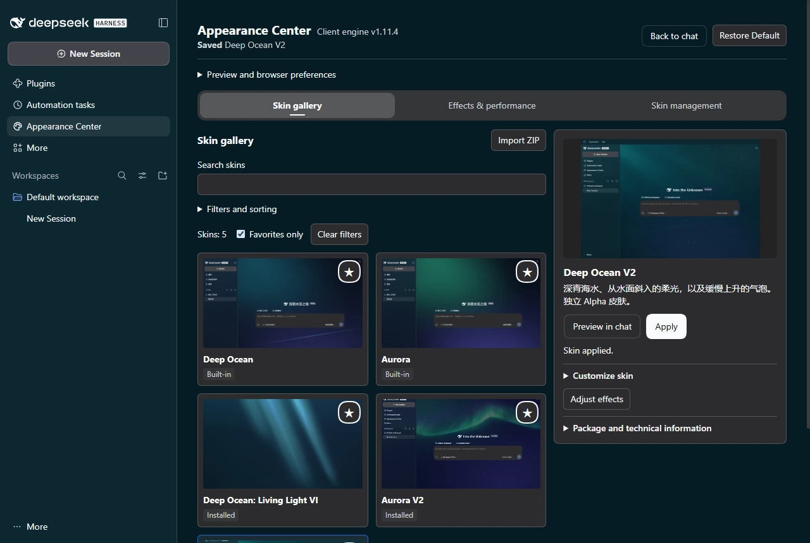
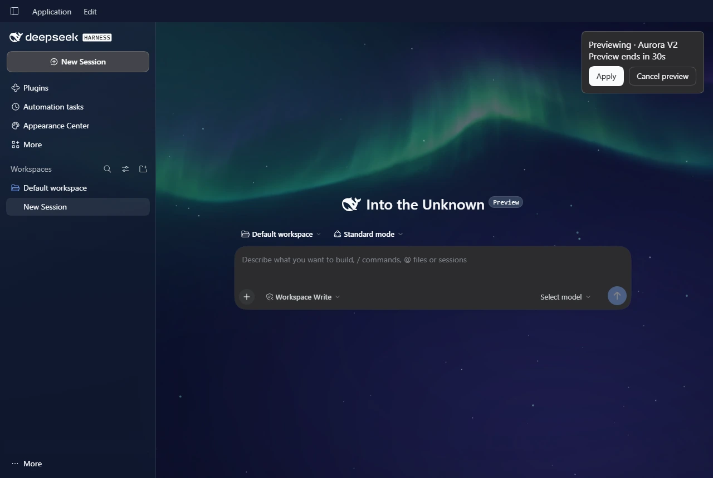

# V2-01 · Alpha 共存验收

验收基线为 `7c3021dc7c6f505e6992594dc3d4ec26ed016166`。官方 DSH Web 和 Windows Desktop 均运行 `0.2.2-rc.5`，共用已发行的 Skin Engine `1.11.4` 安装包及从该基线复建的三份皮肤 ZIP。引擎源码、构建配置、原版 Deep Ocean、原版 Aurora 和浮光深境 VI 的源文件均与 `v1.11.4` 一致。

| 输入产物 | 版本 | SHA-256 |
| --- | --- | --- |
| Skin Engine | 1.11.4 | `7edc9275aa4c0acc378550e884352db721991f8f661d1c4b8a9a17cf09f2cd23` |
| Deep Ocean V2 | 0.1.0 Alpha | `2017c9a2fbfbfb4b6fd5d58d51a4fe70db32b05800334433d39866681be9f3b9` |
| Aurora V2 | 0.1.0 Alpha | `dc5928836f10e2f48111f580d4581fab7fced34fc73d03d567a3037096200472` |
| 浮光深境 VI | 1.2.0 | `2586d48187aa8a3219d6de588835600f37fc1cbe729a9843c01179e342d8f091` |

## 双端结果

| 操作 | Web | Windows Desktop |
| --- | --- | --- |
| 导入、身份与切换 | 两款原版、两款 V2 和浮光深境 VI 均可应用。重复导入 Deep Ocean V2 返回 `duplicate-id` | 同左 |
| 手动取消 | Deep Ocean V2 恢复为已保存的 Deep Ocean 原版 | 同左 |
| 自然到期 | Aurora V2 在 30.558 秒后恢复为已保存的 Aurora 原版 | 30.558 秒后恢复 |
| 重启与收藏 | 重启宿主和 Chrome 后保留 Deep Ocean V2、已安装 ZIP、四款独立透明度偏好和五项收藏 | 重启 Desktop 后同左 |
| 独立卸载 | 先卸载 Deep Ocean V2，Aurora V2 继续应用。再卸载 Aurora V2，浮光深境 VI 仍能渲染。原版偏好和收藏保留 | 同左 |
| 关闭 | 两次测试启动均退出，页面错误为零 | 同左 |

两端都核对了已安装的 Host 和 Client 字节。Windows 首次运行使用系统 DPI 后卡在缩略图加载，测试进程随后退出。验收夹具切换到仓库设置专项使用的 DPR 1 窗口配置后，Windows 在 1280 × 860 CSS 像素通过。详细步骤、输入哈希和每次退出状态见[结构化证据](evidence/v2-01.json)。

## 关键截图

| Web 重启后查看收藏 | Windows Desktop 预览 Aurora V2 |
| --- | --- |
| [](images/v2-01/web-favorites-after-restart.webp) | [](images/v2-01/desktop-aurora-v2-preview.webp) |

[Windows Desktop 实拍浮光深境 VI](images/v2-01/desktop-living-light-vi.webp)

## 复跑

在已执行 `npm ci --ignore-scripts` 的仓库根目录准备输入。从 [v1.11.4 发行页](https://github.com/Activer007/dsh-skin-engine/releases/tag/v1.11.4) 下载引擎安装包到输入目录，核对上表的 SHA-256。

```powershell
$inputs = '.cache/v2-01/inputs'
New-Item -ItemType Directory -Force $inputs
npm run build
foreach ($skin in 'deep-ocean-v2','aurora-v2','living-light') {
  node scripts/pack-samples.mjs --source "skin-sources/examples/skins/$skin" $inputs
}
```

使用已核对版本的 DSH Web CLI、Chrome 和独立解包的 Windows Desktop。替换示例中的三个程序路径。

```powershell
$common = @('--host-version','0.2.2-rc.5',
  '--archive',(Join-Path $inputs 'dsh-plugin-skin-engine-1.11.4.tgz'),
  '--zip-dir',$inputs,'--output','.cache/v2-01')
node scripts/acceptance/v2-coexistence.mjs @common --platform web --web-cli '<official DSH lib/bin.js>' --chrome '<Chrome executable>'
node scripts/acceptance/v2-coexistence.mjs @common --platform desktop --desktop-exe '<DeepSeek Harness.exe>'
```

两端各建一份专用 DSH 配置。Web 重启时继续使用同一个回环端口和隔离浏览器配置，复验按浏览器来源保存的收藏。脚本把结构化结果和窗口截图写到各自的运行目录。
